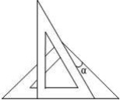

（3分）一副三角板按如图所示的位置叠放在一起，则图中 $\angle\alpha$ 的度数是（）

A. $5^{\circ}$

B. $10^{\circ}$

C. $15^{\circ}$

D. $20^{\circ}$

> [!question]- 点击查看答案与解析
> 【答案】C
> 
> 【考点】三角形内角与外角（三角板叠放） → [[【初中数学知识点体系-人教版】#13-3 三角形的内角与外角]]
> 
> 【解析】
> 一副三角板（含 $30^{\circ}$/$60^{\circ}$ 与 $45^{\circ}$/$45^{\circ}$）叠放时，$\angle\alpha$ 等于 $60^{\circ}$ 与 $45^{\circ}$ 的差：
> $\angle\alpha=60^{\circ}-45^{\circ}=15^{\circ}$。
> 
> 【易错点】三角板固定角度记忆：一副三角板两个三角形分别为 $45^{\circ}/45^{\circ}/90^{\circ}$ 与 $30^{\circ}/60^{\circ}/90^{\circ}$。
