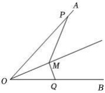

（3分）如图，点 $M$ 是 $\angle AOB$ 平分线上的一点，点 $P$、点 $Q$ 分别在射线 $OA$、射线 $OB$ 上，满足 $OP=2OQ$，若 $\triangle OMP$ 的面积是 2，则 $\triangle OQM$ 的面积是（）

A. 1

B. 2

C. 3

D. 4

> [!question]- 点击查看答案与解析
> 【答案】A
> 
> 【考点】角平分线的性质（距离相等）+ 三角形面积 → [[【初中数学知识点体系-人教版】#14-3 角的平分线]]
> 
> 【解析】
> $\because M$ 在 $\angle AOB$ 的平分线上，$\therefore M$ 到 $OA$、$OB$ 两侧的距离相等，设为 $h$。
> $S_{\triangle OMP}=\frac{1}{2}\cdot OP\cdot h=2$；
> $S_{\triangle OQM}=\frac{1}{2}\cdot OQ\cdot h$。
> 由 $OP=2OQ$，代入得：$S_{\triangle OQM}=\frac{1}{2}\cdot(\frac{1}{2}OP)\cdot h=\frac{1}{2}\times2=1$。
> 
> 【易错点】角平分线上的点到"两边的距离"是垂直距离，而非任意线段长度。
