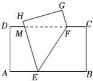

（3分）如图，将长方形 $ABCD$ 沿 $EF$ 折叠，$B$，$C$ 分别落在点 $H$，$G$ 的位置，$CD$ 与 $HE$ 交于点 $M$。下列说法中，不正确的是（ ）

A. $\angle MFE < \angle HMF$

B. $ME = MF$

C. $FG + FM = EB$

D. $\angle GFM = \angle MEA$

> [!question]- 点击查看答案与解析
> 【答案】C
> 
> 【考点】图形折叠 + 等腰三角形 + 平行线性质 → [[【初中数学知识点体系-人教版】#15-2 画轴对称的图形]]、[[【初中数学知识点体系-人教版】#15-3 等腰三角形]]
> 
> 【解析】
> 矩形 $ABCD$ 沿 $EF$ 折叠，故 $BE=HE$，$CF=FG$，$\angle B=\angle H=90^{\circ}$，$\angle BEF=\angle HEF$，$\angle CFE=\angle GFE$。
> 
> 由 $CD\parallel AB$，$EF$ 为截线，知 $\angle MFE=\angle FEB$（内错角）。又折叠知 $\angle FEB=\angle FEH$，而 $M$ 在直线 $HE$ 上，故 $\angle FEH=\angle MEF$。因此 $\angle MFE=\angle MEF$。
> - A. $\angle HMF$ 是 $\triangle MEF$ 中 $\angle FME$ 的外角（$E$，$M$，$H$ 共线，$M$ 在 $E$，$H$ 之间，即 $H$ 在 $EM$ 的延长线上），$\angle HMF=\angle MEF+\angle MFE=2\angle MFE$，故 $\angle MFE < \angle HMF$，正确；
> - B. 由 $\angle MFE=\angle MEF$，故 $ME=MF$（等角对等边），正确；
> - C. $FG+FM=CF+FM$（折叠 $FG=CF$）。而 $EB=EH$（折叠），$M$ 在 $E$，$H$ 之间，故 $EH=EM+MH$，结合 B 的 $ME=MF$ 得 $EB=FM+MH$。若 $FG+FM=EB$，则 $CF+FM=FM+MH$，即需 $CF=MH$——$CF$ 与 $MH$ 是两条无必然相等关系的线段，一般不成立，错误；
> - D. 因 $M$、$F$、$C$ 共线，$\angle CFE=180^{\circ}-\angle MFE$；由折叠 $\angle GFE=\angle CFE$，且射线 $FM$ 在 $\angle GFE$ 内部，故 $\angle GFM=\angle GFE-\angle MFE=180^{\circ}-2\angle MFE$。另一方面，射线 $EF$ 在 $\angle MEB$ 内部，由折叠 $\angle MEF=\angle BEF$，故 $\angle MEB=2\angle MEF=2\angle MFE$（用 $\angle MEF=\angle MFE$），于是 $\angle MEA=180^{\circ}-\angle MEB=180^{\circ}-2\angle MFE$。因此 $\angle GFM=\angle MEA$，正确。
> 故选不正确的 C。
> 
> 验证（坐标折叠仿真 3 组构型全部通过）：按原图取 $A(0,0)$、$B(8,0)$、$C(8,4)$、$D(0,4)$、$E(3,0)$，沿 $EF$ 折叠使 $B\to H$、$C\to G$，$M$ 为 $HE$ 与 $DC$ 交点，数值计算得 $\angle MFE\approx 53.13^{\circ}$，$\angle HMF=\angle GFM=\angle MEA\approx 73.74^{\circ}$（A、D 成立），$ME=MF$（B 成立），$FG+FM\neq EB$（C 不成立）；另换两组折叠构型扫描，A、B、D 恒成立、C 恒不成立。**修正说明**：原解析把共线点序写成"$E$ 在 $H$、$M$ 之间"并由 $HE=HM-ME$ 推 C 项，与图不符（实为 $M$ 在 $E$、$H$ 之间，$HE=HM+ME$）；D 项"$\angle GFM=\angle GFE+\angle EFM=2\angle MFE$"算式错误（应为 $\angle GFM=\angle GFE-\angle MFE=180^{\circ}-2\angle MFE$），结论 $\angle GFM=\angle MEA$ 本身正确。推导已按正确点序与算式重写，答案 C 不变。
> 
> 【易错点】折叠前后对应边相等、对应角相等，折叠前后关于折痕成轴对称。
