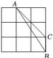

（3分）如图，在正方形方格中，点 $A$，$B$，$C$ 在格点上，则 $\angle CAB + \angle ABC$ 的度数是 ___ 。

> [!question]- 点击查看答案与解析
> 【答案】$45^{\circ}$
> 
> 【考点】三角形外角定理、全等三角形的判定（SSS）+ 正方形格点 → [[【初中数学知识点体系-人教版】#13-3 三角形的内角与外角]]、[[【初中数学知识点体系-人教版】#14-2 三角形全等的判定]]
> 
> 【解析】
> 以方格左下角为原点、格线边长为 1 建系，由原卷图读出 $A(1,3)$、$C(3,1)$、$B(3,0)$。
> $B$、$C$ 与格点 $P(3,3)$ 在同一条竖直格线上，射线 $CP$ 即 $BC$ 沿格线向上的延长线。
> 由三角形外角定理：$\angle CAB+\angle ABC$ 等于 $\angle ACB$ 在顶点 $C$ 处的外角 $\angle ACP$。
> 线段 $CA$ 是以 $(1,1)$、$C(3,1)$、$P(3,3)$、$A(1,3)$ 为顶点、边长为 2 的方格正方形的对角线。连接 $(1,1)$ 与 $CA$ 把正方形分成两个三角形：它们的两条直角边都等于格线长 2，且公共边为 $CA$，由 SSS 全等，故 $CA$ 平分 $C$ 处竖直线与水平线夹成的直角，即 $\angle ACP=\frac{1}{2}\times 90^{\circ}=45^{\circ}$。
> 所以 $\angle CAB+\angle ABC=45^{\circ}$。
> 
> 验证（数值自校验 4 项全部通过）：坐标法 $A(1,3)$、$B(3,0)$、$C(3,1)$：$\angle CAB\approx 11.31^{\circ}$、$\angle ABC\approx 33.69^{\circ}$，和为 $45.00^{\circ}$；$\angle ACB=135^{\circ}$，与 $180^{\circ}-135^{\circ}=45^{\circ}$ 一致；$CA$ 与竖直向上射线夹角 $=45^{\circ}$，与"对角线平分直角"推导吻合；三点位置与原 $3\times 3$ 方格图一致。**修正说明**：原解析使用勾股定理及其逆定理（八下第 17 章，对八上超纲），且所设数据 $AC^{2}=5$、$BC^{2}=5$、$AB^{2}=10$（等腰直角三角形）与原卷图不符（实际 $AC^{2}=8$、$BC^{2}=1$、$AB^{2}=13$，$\angle ACB=135^{\circ}$ 为钝角）。答案 $45^{\circ}$ 正确，已改用课标内方法（外角定理 + SSS 全等）重写。
> 
> 【易错点】一是勿凭"看起来像直角"臆断 $\triangle ABC$ 的形状——本题 $\angle ACB$ 实为 $135^{\circ}$ 钝角；二是两内角之和应转化为第三顶点处的外角（外角定理），而外角大小由格线方向与 $2\times 2$ 正方形对角线（平分直角，可由 SSS 证明）确定。
