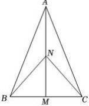

（3分）如图，在 $\triangle ABC$ 中，$AB=AC$。

（1）若 $AM$ 是 $BC$ 边上的高，则可以推出 $BM=MC$。依据是 ___ 。

（2）在问题（1）的基础上，若点 $N$ 在 $AM$ 上，则由 $BM=MC$，$AM\perp BC$，可以进一步推出 $NB=NC$。依据是 ___ 。

> [!question]- 点击查看答案与解析
> 【答案】（1）等腰三角形的三线合一；（2）线段垂直平分线上的点到线段两端点的距离相等
> 
> 【考点】等腰三角形三线合一 + 垂直平分线性质 → [[【初中数学知识点体系-人教版】#15-3 等腰三角形]]、[[【初中数学知识点体系-人教版】#15-1 图形的轴对称]]
> 
> 【解析】
> （1）$\because AB=AC$，$AM$ 是 $BC$ 边上的高，由等腰三角形"三线合一"，$AM$ 也是 $BC$ 的中线，故 $BM=MC$。
> （2）$\because BM=MC$，$AM\perp BC$，$\therefore AM$ 是线段 $BC$ 的垂直平分线。
> 又 $N$ 在 $AM$ 上，由"线段垂直平分线上的点到线段两端点的距离相等"，得 $NB=NC$。
> 
> 【易错点】垂直平分线性质应用前提：点必须在垂直平分线上。
