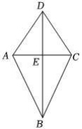

（3分）如图，在四边形 $ABCD$ 中，$AD=CD$，$AB=CB$。我们把这种两组邻边分别相等的四边形叫做“筝形”，下列结论：$①AE=CE$；$②BE=DE$；$③BD\perp AC$；$④$ 四边形 $ABCD$ 的面积等于 $\frac{1}{2}AC\times BD$。其中正确的有 ___ 。（填序号）

> [!question]- 点击查看答案与解析
> 【答案】$①③④$
> 
> 【考点】全等与轴对称（筝形） → [[【初中数学知识点体系-人教版】#15-3 等腰三角形]]、[[【初中数学知识点体系-人教版】#15-1 图形的轴对称]]
> 
> 【解析】
> 筝形 $ABCD$ 中，$AD=CD$，$AB=CB$，对角线 $AC$、$BD$ 交于 $E$。$BD$ 所在直线是筝形的对称轴。
> - 由 SSS 可证 $\triangle ABD\cong\triangle CBD$，从而 $\angle ABE=\angle CBE$，$\angle ADE=\angle CDE$。
> - 由 $AB=CB$，$\angle ABE=\angle CBE$，$BE=BE$，故 $\triangle ABE\cong\triangle CBE$，得 $AE=CE$、$\angle AEB=\angle CEB=90^{\circ}$，即 $BD\perp AC$（$①③$ 正确）。
> - $\triangle ADE\cong\triangle CDE$ 只能推出 $AE=CE$ 与 $\angle AED=\angle CED=90^{\circ}$，推不出 $BE=DE$：对称轴 $BD$ 垂直平分另一条对角线 $AC$，但 $AC$ 并不平分 $BD$（原卷图中也可见 $DE$ 明显短于 $EB$），只有菱形时才有 $BE=DE$（$②$ 错误）。
> - 面积：$S_{ABCD}=S_{\triangle ABC}+S_{\triangle ADC}=\frac{1}{2}AC\cdot BE+\frac{1}{2}AC\cdot DE=\frac{1}{2}AC\cdot BD$（$④$ 正确）。
> 综上，正确的有 $①③④$。
> 
> 验证（坐标法 4 项全部通过）：取 $B(0,0)$、$D(0,6)$、$A(-2,4)$、$C(2,4)$（满足 $AD=CD$、$AB=CB$，构型同原图 $D$ 上 $B$ 下）：$AE=CE=2$（①✓）；$BD$ 竖直、$AC$ 水平（③✓）；$BE=4\neq DE=2$（②✗）；面积 $=\frac{1}{2}\times 4\times 6=12$，与分块求和一致（④✓）。另扫描多组一般筝形数据，①③④ 恒成立、② 仅菱形特例成立。**修正说明**：原解析"同理 $\triangle ADE\cong\triangle CDE$，$BE=DE$"属逻辑错误——该全等推不出 $BE=DE$，答案由 $①②③④$ 修正为 $①③④$。
> 
> 【易错点】筝形与菱形区分：筝形是两组邻边相等，菱形是四边都相等；筝形的对称轴对角线垂直平分另一条对角线，但两条对角线不互相平分（一般 $BE\neq DE$）。
