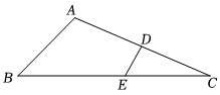

（3分）如图，在 $\triangle ABC$ 中，$DE$ 垂直平分 $AC$，若 $\angle B=50^{\circ}$，$EC=AB$，则 $\angle C$ 的度数是 ___ 。

> [!question]- 点击查看答案与解析
> 【答案】$25^{\circ}$
> 
> 【考点】垂直平分线 + 等腰三角形外角 → [[【初中数学知识点体系-人教版】#15-1 图形的轴对称]]、[[【初中数学知识点体系-人教版】#15-3 等腰三角形]]
> 
> 【解析】
> $\because DE$ 垂直平分 $AC$，$\therefore AE=EC$，$AD=CD$，$\angle C=\angle EAC$。
> 又 $EC=AB$，$\therefore AE=AB$，$\triangle ABE$ 为等腰三角形，$\angle B=\angle AEB=50^{\circ}$。
> $\because \angle AEB=\angle C+\angle EAC=2\angle C$（外角定理），
> $\therefore 2\angle C=50^{\circ}$，$\angle C=25^{\circ}$。
> 
> 验证（回代自校验 3 项全部通过）：$\angle C=25^{\circ}$ 时 $\angle EAC=25^{\circ}$、$\angle AEB=50^{\circ}=\angle B$、$\angle BAE=80^{\circ}$，$\triangle ABC$ 三角和 $=50^{\circ}+25^{\circ}+(80^{\circ}+25^{\circ})=180^{\circ}$ ✓；$AE=AB$ 且 $AE=EC$ 得 $EC=AB$ ✓；若取 $\angle C=40^{\circ}$ 则 $\angle AEB=80^{\circ}\neq 50^{\circ}$，与 $AE=AB$ 矛盾 ✗。**修正说明**：原解析正确列出 $2\angle C=50^{\circ}$，却把解写成 $\angle C=40^{\circ}$，算术自相矛盾；答案修正为 $25^{\circ}$。
> 
> 【易错点】垂直平分线推出等腰三角形，再利用外角定理列方程；解方程 $2\angle C=50^{\circ}$ 得 $\angle C=25^{\circ}$，勿误算成 $40^{\circ}$。
