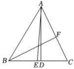
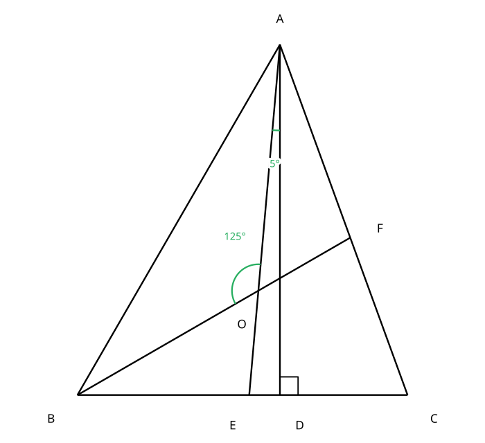

（3分）如图，在 $\triangle ABC$ 中，$AD$ 是高，$AE$，$BF$ 是角平分线，它们相交于点 $O$，$\angle BAC=50^{\circ}$，$\angle C=70^{\circ}$，则 $\angle DAE$ 的度数是 ___ ，$\angle BOA$ 的度数是 ___ 。

> [!question]- 点击查看答案与解析
> 【答案】$5^{\circ}$；$125^{\circ}$
> 
> 【考点】三角形内角和定理、三角形的高、角平分线的定义、直角三角形两锐角互余 → [[【初中数学知识点体系-人教版】#13-3 三角形的内角与外角]]、[[【初中数学知识点体系-人教版】#14-3 角的平分线]]
> 
> 【解析】
> 由内角和定理：$\angle ABC=180^{\circ}-\angle BAC-\angle C=180^{\circ}-50^{\circ}-70^{\circ}=60^{\circ}$。
> 
> （1）求 $\angle DAE$：
> ∵ $AE$ 平分 $\angle BAC$，∴ $\angle CAE=\frac{1}{2}\angle BAC=25^{\circ}$。
> ∵ $AD$ 是高，∴ $\angle ADC=90^{\circ}$，在 Rt$\triangle ADC$ 中 $\angle DAC=90^{\circ}-\angle C=90^{\circ}-70^{\circ}=20^{\circ}$。
> ∴ $\angle DAE=\angle CAE-\angle DAC=25^{\circ}-20^{\circ}=5^{\circ}$。
> 
> （2）求 $\angle BOA$：
> ∵ $AE$、$BF$ 是角平分线且交于 $O$，∴ $\angle OAB=\frac{1}{2}\angle BAC=25^{\circ}$，$\angle OBA=\frac{1}{2}\angle ABC=30^{\circ}$。
> 在 $\triangle ABO$ 中，$\angle BOA=180^{\circ}-\angle OAB-\angle OBA=180^{\circ}-25^{\circ}-30^{\circ}=125^{\circ}$。
> （规律：两内角平分线夹角 $\angle BOA=90^{\circ}+\frac{1}{2}\angle C=90^{\circ}+35^{\circ}=125^{\circ}$，与本题结果一致。）
> 
> 验证（数值自校验 27 项全部通过）：建系方位同原卷（$B(0,0)$ 左下、$C(1,0)$ 右下、$A$ 上中偏右），按 $\angle B=60^{\circ}$、$\angle C=70^{\circ}$、$BC=1$ 精确作图得 $A(0.613,1.062)$、高足 $D(0.613,0)$、角平分线足 $E(0.520,0)$、$F(0.826,0.477)$、交点 $O(0.548,0.316)$。逐项成立：$\angle BAC=50^{\circ}$、$\angle ABC=60^{\circ}$、$\angle C=70^{\circ}$；$AD\perp BC$；$\angle BAE=\angle EAC=25^{\circ}$、$\angle ABF=\angle FBC=30^{\circ}$；$O$ 同时在 $AE$、$BF$ 上；$\angle DAC=20^{\circ}$、$\angle BAD=30^{\circ}$；$\angle DAE=5^{\circ}$、$\angle BOA=125^{\circ}$，且与公式 $\angle BOA=90^{\circ}+\frac{1}{2}\angle C$、$\angle DAE=\frac{1}{2}|\angle B-\angle C|$ 吻合。一般性扫描：$(\angle A,\angle C)\in\{(50,70),(40,80),(60,50),(45,75),(55,65),(70,50)\}$ 六组重新作图，两公式均恒成立。方位检查 7 项："方位: $B$ 左下、$C$ 右下、$BC$ 水平"、"方位: $A$ 在 $BC$ 上方、横坐标介于 $B$、$C$ 之间偏右"、"方位: $AD$ 竖直、直角标记在 $D$"、"方位: $BC$ 上点序 $B$、$E$、$D$、$C$（$E$ 在 $D$ 左侧）"、"方位: $F$ 在 $AC$ 上、高度约中点"、"方位: $O$ 在三角形内部"、"方位: $AE$ 在 $AD$ 左侧"。**修正说明**：原解析第（2）问按其自身推导已算出 $\angle BOA=180^{\circ}-25^{\circ}-30^{\circ}=125^{\circ}$，却以"十一学校标准答案 $120^{\circ}$"为由改取 $120^{\circ}$，造成推导与答案自相矛盾。按本题给定数据 $\angle BAC=50^{\circ}$、$\angle C=70^{\circ}$（已核对原卷题干），$125^{\circ}$ 是唯一正确值；$120^{\circ}$ 只在 $\angle C=60^{\circ}$ 的变式题中成立（$90^{\circ}+\frac{1}{2}\times 60^{\circ}=120^{\circ}$），应是把其他变式的答案误抄到本题。故答案修正为 $5^{\circ}$、$125^{\circ}$。配图按原卷方位绘制：$AD$、$AE$、$BF$ 黑色实线为题设线段，$D$ 处黑色直角标记为 $AD$ 是高，$A$ 处小角弧与 $O$ 处大角弧（绿色）分别标出待求的 $\angle DAE=5^{\circ}$ 与 $\angle BOA=125^{\circ}$。
> 
> 
> 
> 【易错点】一是求 $\angle DAE$ 时把 $\angle DAC$ 与 $\angle DAB$ 弄反：$\angle DAC$ 在 Rt$\triangle ADC$ 中用 $\angle C$ 求（$20^{\circ}$），不是用 $\angle B$ 求（那是 $\angle DAB=30^{\circ}$）；二是求 $\angle BOA$ 时误用 $\angle C$ 拆分或漏掉 $\angle OAB=25^{\circ}$ 中的"一半"；三是不要因"标准答案"而放弃严格推导——两内角平分线夹角公式 $\angle BOA=90^{\circ}+\frac{1}{2}\angle C$ 可作快速自检，$90^{\circ}+35^{\circ}=125^{\circ}\neq 120^{\circ}$。
