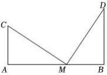

（3分）如图，两根旗杆 $AC$ 和 $BD$ 垂直于地面 $AB$ 放置，它们相距 $AB=12$ m。某人从点 $B$ 出发，沿 $BA$ 方向走了 $5$ m 到达点 $M$ 处。此时，他仰望旗杆的顶点 $C$ 和 $D$，两次视线的夹角 $\angle CMD=90^{\circ}$，且 $CM=DM$，则可以推知旗杆 $AC$ 的长是 ___ $m$，旗杆 $BD$ 的长是 ___ $m$。

> [!question]- 点击查看答案与解析
> 【答案】$5$；$7$
> 
> 【考点】全等三角形判定（AAS） + 直角三角形 → [[【初中数学知识点体系-人教版】#14-2 三角形全等的判定]]
> 
> 【解析】
> $\because AC\perp AB$，$BD\perp AB$，$\therefore \angle A=\angle B=90^{\circ}$。
> 由 $\angle CMD=90^{\circ}$，得 $\angle CMA+\angle DMB=90^{\circ}$。
> 又 $\angle CMA+\angle ACM=90^{\circ}$，$\therefore \angle ACM=\angle DMB$。
> 在 $\triangle ACM$ 和 $\triangle BMD$ 中：
>   $\begin{cases} \angle A=\angle B \\ \angle ACM=\angle DMB \\ CM=MD \end{cases}$
> $\therefore \triangle ACM\cong\triangle BMD$（AAS）。
> $\therefore AM=BD$，$AC=BM$。
> 由 $BM=5$，得 $AC=5$ m；
> 由 $AM=AB-BM=12-5=7$，得 $BD=7$ m。
> 
> 验证（坐标法 3 项全部通过）：取 $A(0,0)$、$B(12,0)$、$M(7,0)$（$BM=5$），设 $AC=5$、$BD=7$ 即 $C(0,5)$、$D(12,7)$：$\vec{MC}\cdot\vec{MD}=(-7)(5)+(5)(7)=0$，$\angle CMD=90^{\circ}$ ✓；$|CM|=\sqrt{74}=|DM|$ ✓；两旗杆均垂直地面 ✓。该方程组解唯一（$AC=5$、$BD=7$）。**修正说明**：原解析中段已正确推出 $AC=BM=5$、$BD=AM=7$，末行却写"故 $AC=7$ m，$BD=5$ m"，与自身推导矛盾；全等对应为 $A\leftrightarrow B$、$C\leftrightarrow M$、$M\leftrightarrow D$，$AC$ 与 $BM$ 是对应边，答案修正为 $AC=5$、$BD=7$。
> 
> 【易错点】一是本题条件 $CM=DM$ 推出 $\triangle ACM\cong\triangle BMD$ 后，对应边是 $AC\leftrightarrow BM$、$AM\leftrightarrow BD$（交叉对应），勿按字母顺序误读；二是 $M$ 从 $B$ 出发走了 5 m，故 $BM=5$、$AM=7$，不要弄反。
