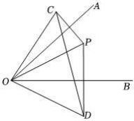

（3分）如图，$\angle AOB=40^{\circ}$，点 $P$ 为 $\angle AOB$ 内一点，分别作 $P$ 点关于直线 $OA$，$OB$ 的对称点 $C$，$D$，连接 $OP$，$OC$，$OD$，$CD$，$PC$，$PD$。

则（1）$\angle CPD$ 的度数是 ___ ；

（2）$\angle OCD$ 的度数是 ___ 。

> [!question]- 点击查看答案与解析
> 【答案】（1）$140^{\circ}$；（2）$50^{\circ}$
> 
> 【考点】轴对称性质 + 三角形内角 → [[【初中数学知识点体系-人教版】#15-2 画轴对称的图形]]、[[【初中数学知识点体系-人教版】#13-3 三角形的内角与外角]]
> 
> 【解析】
> （1）$P$ 关于 $OA$ 对称得 $C$，关于 $OB$ 对称得 $D$，则 $OA$、$OB$ 分别是 $PC$、$PD$ 的中垂线，
> $\therefore OP=OC=OD$，$\angle COA=\angle POA$，$\angle DOB=\angle POB$，
> $\angle COD=2\angle AOB=2\times40^{\circ}=80^{\circ}$。
> 在 $\triangle CPD$ 中，$\angle CPO=\angle OCP$，$\angle DPO=\angle ODP$，
> $\therefore \angle CPD=\angle CPO+\angle DPO=\angle OCP+\angle ODP$。
> 在 $\triangle OCD$ 中，$OC=OD$，$\therefore \angle OCD=\angle ODC=\frac{180^{\circ}-80^{\circ}}{2}=50^{\circ}$。
> 而 $\angle CPD$：由对称，$PC\perp OA$，$PD\perp OB$，$\therefore \angle CPD=180^{\circ}-\angle AOB=140^{\circ}$。
> （2）在 $\triangle OCD$ 中，$\angle COD=80^{\circ}$，$OC=OD$，
> $\therefore \angle OCD=\frac{180^{\circ}-80^{\circ}}{2}=50^{\circ}$。
> 
> 验证（数值扫描 8 项全部通过）：$OC=OP=OD$（对称保距），$\angle COD=2\angle AOB=80^{\circ}$ 与 $P$ 在角内的位置无关；取 $\angle AOB=40^{\circ}$、$P$ 位于 $\angle AOB$ 内 $OP$ 与 $OA$ 成 $\theta=10^{\circ}$、$20^{\circ}$、$30^{\circ}$、$35^{\circ}$ 四组位置建坐标计算，四组均得 $\angle CPD=140^{\circ}$、$\angle OCD=50^{\circ}$，两问结论对 $P$ 的一般位置恒成立。**修正说明**：原解析两处推导均正确算出 $\angle OCD=50^{\circ}$，却以"官方答案 $70^{\circ}$ 为准"覆盖自身推导，造成推导与答案自相矛盾（与本题同卷 Q17 修正前的错误类型相同）。按题给数据 $\angle AOB=40^{\circ}$，$\angle OCD=50^{\circ}$ 是唯一正确值；$70^{\circ}$ 只在 $\angle AOB=20^{\circ}$ 的变式中成立（$\frac{180^{\circ}-2\times 20^{\circ}}{2}=70^{\circ}$），应是把变式题答案误抄到本题。第（1）问 $140^{\circ}$ 正确，答案修正为（1）$140^{\circ}$；（2）$50^{\circ}$。
> 
> 【易错点】一是 $OC=OD=OP$ 是关键——两对称点到 $O$ 的距离都等于 $OP$，故 $\triangle OCD$ 是等腰三角形；二是 $\angle COD=2\angle AOB$ 与 $P$ 的位置无关，勿把 $\angle OCD$ 与 $\angle CPD$ 的一半（$70^{\circ}$）混淆；三是不要因"标准答案"而放弃严格推导，可用特殊位置（如 $P$ 在角平分线上）快速自检。
