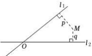

（3分）如图，平面中两条直线 $l_{1}$ 和 $l_{2}$ 相交于点 $O$，对于平面上任意一点 $M$，若点 $M$ 到直线 $l_{1}$、$l_{2}$ 的距离分别是 $p$ cm、$q$ cm，则称有序实数对 $(p,q)$ 是点 $M$ 的“距离坐标”。特别地，当点在直线上时，定义点到直线的距离为 $0$。下列说法：

$①$“距离坐标”是 $(0,0)$ 的点只有点 $O$；

$②$“距离坐标”是 $(0,1)$ 的点只有 $1$ 个；

$③$“距离坐标”是 $(2,2)$ 的点共有 $4$ 个；

正确的有 ___ （填序号）。

> [!question]- 点击查看答案与解析
> 【答案】$①③$
> 
> 【考点】新定义（距离坐标） → [[【初中数学知识点体系-人教版】#9-2 坐标方法的简单应用]]、[[【初中数学知识点体系-人教版】#15-1 图形的轴对称]]
> 
> 【解析】
> $①$ $p=0,q=0$ 即同时到两条直线距离都为 0 的点，即两直线交点，只有 $O$ 一点，正确；
> $②$ $p=0,q=1$ 即到 $l_{1}$ 距离为 0（在 $l_{1}$ 上）且到 $l_{2}$ 距离为 1 的点，在 $l_{1}$ 上有 2 个（分布在 $O$ 的两侧），并非 1 个，错误；
> $③$ $p=2,q=2$ 即到两条直线距离分别为 2 和 2 的点，每个角的分角线两侧各有一个，共 $2\times2=4$ 个（两条距离线相交形成 4 个交点），正确。
> 故正确：$①③$。
> 
> 【易错点】距离坐标是距离，距离为 $p$ 可在直线两侧分别取平行线，得到两对点。
