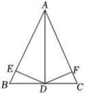

（5分）如图，在 $\triangle ABC$ 中，$BD=CD$，$DE\perp AB$ 于点 $E$，$DF\perp AC$ 于点 $F$，若 $BE=CF$。求证：$AD$ 平分 $\angle BAC$。

请你补全下述证明过程：

证：∵ $DE \perp AB$，$DF \perp AC$

$\therefore \angle BED = \angle CFD = 90^{\circ}$

在 Rt $\triangle DBE$ 和 Rt $\triangle DCF$ 中，$\begin{cases}BD=CD \\ (①)=(②)\end{cases}$，$①$ ___ ，$②$ ___ ，

$\therefore Rt\triangle DBE \cong Rt\triangle DCF$ （ ___ ）

$\therefore DE=DF$

∵ $DE=DF$，___ ，___

∴ $AD$ 平分 $\angle BAC$

> [!question]- 点击查看答案与解析
> 【答案】$①$ $BE=CF$；$②$ 斜边直角边（HL）；$DE\perp AB$，$DF\perp AC$；角平分线的判定（到角两边距离相等的点在角平分线上）
> 
> 【考点】直角三角形全等（HL）+ 角平分线判定 → [[【初中数学知识点体系-人教版】#14-2 三角形全等的判定]]、[[【初中数学知识点体系-人教版】#14-3 角的平分线]]
> 
> 【解析】
> 证：$\because DE \perp AB$，$DF \perp AC$
> $\therefore \angle BED = \angle CFD = 90^{\circ}$
> 在 Rt $\triangle DBE$ 和 Rt $\triangle DCF$ 中，$\begin{cases} BD=CD \\ BE=CF \end{cases}$，
> $\therefore Rt\triangle DBE \cong Rt\triangle DCF$（HL）
> $\therefore DE=DF$
> $\because DE=DF$，$DE\perp AB$，$DF\perp AC$，
> $\therefore AD$ 平分 $\angle BAC$（角的内部到角两边距离相等的点在角的平分线上）。
> 
> 【易错点】HL 只能用于直角三角形，且顺序必须为斜边和一条直角边。
