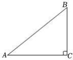

（5分）尺规作图，保留作图痕迹。

如图，在 $\triangle ABC$ 中，$\angle C=90^{\circ}$，在 $AB$ 上取一点 $D$，使得 $AD=AC$，连接 $CD$，作 $CD$ 的垂直平分线交 $BC$ 于点 $E$。

（1）补全图形；

（2）$\angle BAC$ 与 $\angle BCD$ 满足的等量关系是 ___ 。

> [!question]- 点击查看答案与解析
> 【答案】（1）作图见解析；（2）$\angle BAC=2\angle BCD$
> 
> 【考点】尺规作图 + 等腰三角形性质 → [[【初中数学知识点体系-人教版】#15-3 等腰三角形]]、[[【初中数学知识点体系-人教版】#15-1 图形的轴对称]]
> 
> 【解析】
> （1）作图：在 $AB$ 上截 $AD=AC$；连 $CD$；分别以 $C,D$ 为圆心，大于 $\frac{1}{2}CD$ 的长为半径画弧，两弧交于两点，连线交 $BC$ 于 $E$。
> （2）$\because AD=AC$，$\therefore \angle ACD=\angle ADC=\frac{180^{\circ}-\angle BAC}{2}=90^{\circ}-\frac{\angle BAC}{2}$。
> 又 $\because \angle C=90^{\circ}$，$\therefore \angle BCD=90^{\circ}-\angle ACD=90^{\circ}-(90^{\circ}-\frac{\angle BAC}{2})=\frac{\angle BAC}{2}$。
> 故 $\angle BAC=2\angle BCD$。
> 
> 【易错点】垂直平分线作图的两个圆心点距离必须大于线段一半，否则无交点。
