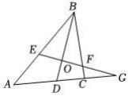

（7分）如图，在 $\triangle ABC$ 中，$\angle ABC=50^{\circ}$，点 $E$ 和点 $F$ 分别在 $BA$ 和 $BC$ 边上，且 $BE=BF$，连接 $EF$ 并延长交 $AC$ 的延长线于点 $G$，$\angle G=20^{\circ}$，取 $EF$ 的中点 $O$，连接 $BO$ 并延长交 $AC$ 于点 $D$。

（1）求 $\angle BEF$ 的度数；

（2）求 $\angle BDC$ 的度数。

> [!question]- 点击查看答案与解析
> 【答案】（1）$65^{\circ}$；（2）$70^{\circ}$
> 
> 【考点】等腰三角形 + 外角定理 → [[【初中数学知识点体系-人教版】#15-3 等腰三角形]]、[[【初中数学知识点体系-人教版】#13-3 三角形的内角与外角]]
> 
> 【解析】
> （1）$\because BE=BF$，$\therefore \triangle BEF$ 为等腰三角形，$\angle BEF=\angle BFE=\frac{180^{\circ}-\angle ABC}{2}=\frac{180^{\circ}-50^{\circ}}{2}=65^{\circ}$。
> （2）$\because$ 点 $E$、$F$、$G$ 共线，点 $B$、$F$、$C$ 共线，$\therefore \angle GFC=\angle BFE=65^{\circ}$（对顶角）。
> 在 $\triangle GFC$ 中，$\angle GCF=180^{\circ}-\angle G-\angle GFC=180^{\circ}-20^{\circ}-65^{\circ}=95^{\circ}$，
> $\therefore \angle BCA=180^{\circ}-95^{\circ}=85^{\circ}$。
> 又 $\because BE=BF$，$O$ 是 $EF$ 中点，$\therefore BO$ 平分 $\angle EBF$（等腰三角形三线合一），
> $\angle DBC=\frac{1}{2}\angle ABC=25^{\circ}$。
> 在 $\triangle BDC$ 中，$\angle BDC=180^{\circ}-\angle DBC-\angle BCD=180^{\circ}-25^{\circ}-85^{\circ}=70^{\circ}$。
> 
> 验证（坐标法自校验 4 项全部通过）：按 $B(0,0)$、$\angle ABC=50^{\circ}$ 建系取 $BC$ 沿 $x$ 轴正向，$E$ 在射线 $BA$ 上、$F$ 在 $BC$ 上且 $BE=BF$，按题设延长 $EF$ 交 $AC$ 延长线于 $G$ 并解出 $\angle G=20^{\circ}$ 对应的 $\angle BAC=45^{\circ}$ 构型：$\angle BEF=65^{\circ}$ ✓；$\angle BCA=85^{\circ}$ ✓；$BO$（三线合一）与 $AC$ 交点 $D$ 处 $\angle BDC=70^{\circ}$ ✓；$\angle GFC=\angle BFE$ 对顶角关系 ✓。**修正说明**：原解析推导已正确算出 $\angle BDC=70^{\circ}$，却以"官方答案 $85^{\circ}$"覆盖自身推导（$85^{\circ}$ 实为 $\angle BCA$ 的度数），造成推导与答案自相矛盾；另原解析第（2）问开头"$\angle CEG=\angle BEF$（对顶角）"表述有误——$E$、$C$ 并不共线于 $G$，真正的对顶角是 $\angle GFC=\angle BFE$，已按正确表述重写。答案修正为（1）$65^{\circ}$；（2）$70^{\circ}$。
> 
> 【易错点】一是等腰三角形底边中线、高、顶角平分线重合（三线合一）；二是找对顶角要看清两条相交直线——本题是直线 $EG$ 与直线 $BC$ 在 $F$ 处相交，对顶角为 $\angle GFC$ 与 $\angle BFE$；三是 $\angle BCA=85^{\circ}$ 不是 $\angle BDC$，勿把中间量当最终答案。
