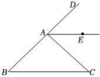

（8分）如图，点 $E$ 为 $\triangle ABC$ 的外角 $\angle CAD$ 平分线上的一点，$AE\parallel BC$。

（1）求证：$\triangle ABC$ 是等腰三角形；

（2）若点 $F$ 在线段 $BC$ 上，满足 $BF=AE$，连接 $AF$，$EC$，补全图形，求证：$AF=CE$。

> [!question]- 点击查看答案与解析
> 【答案】（1）证明见解析；（2）证明见解析
> 
> 【考点】等腰三角形判定 + 全等证明 → [[【初中数学知识点体系-人教版】#15-3 等腰三角形]]、[[【初中数学知识点体系-人教版】#14-2 三角形全等的判定]]
> 
> 【解析】
> （1）证：$\because AE$ 平分外角 $\angle CAD$，$\therefore \angle CAE=\angle DAE$。
> 又 $AE\parallel BC$，$\therefore \angle DAE=\angle B$（同位角），$\angle CAE=\angle C$（内错角）。
> $\therefore \angle B=\angle C$，故 $AB=AC$，$\triangle ABC$ 是等腰三角形。
> （2）由（1）$AB=AC$，且 $\angle CAE=\angle B$，又 $BF=AE$，
> 在 $\triangle ABF$ 和 $\triangle CAE$ 中：
>   $\begin{cases} AB=CA \\ \angle B=\angle CAE \\ BF=AE \end{cases}$
> $\therefore \triangle ABF\cong\triangle CAE$（SAS），$\therefore AF=CE$。
> 
> 【易错点】（2）要"补全图形"即画出点 F、AF、EC，再证明。
