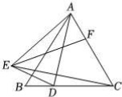
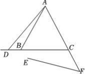
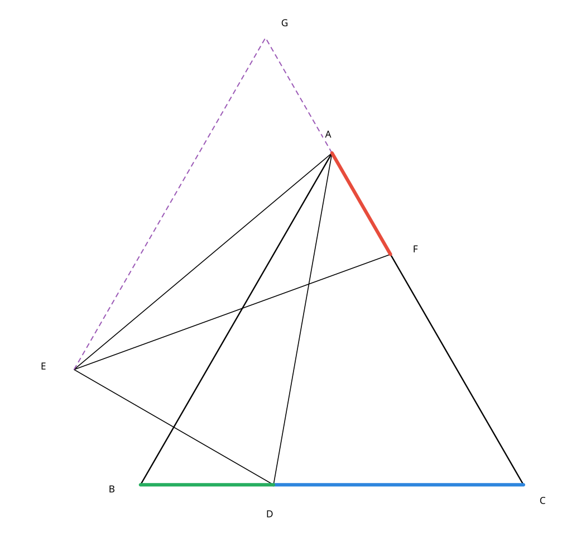
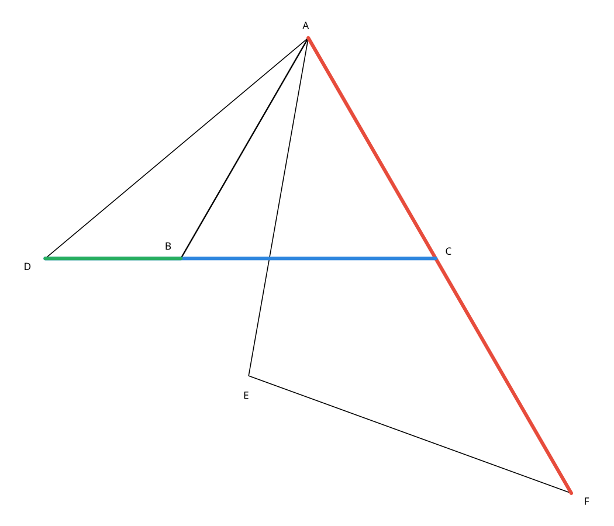

（7分）如图1，已知等边 $\triangle ABC$，点 $D$ 在 $BC$ 边上，$\angle BAD = \alpha$（$0^{\circ} < \alpha < 30^{\circ}$），点 $E$ 是点 $D$ 关于直线 $AB$ 的对称点，点 $F$ 在直线 $AC$ 上，满足 $EF = AD$。

（1）求 $\angle AFE$ 的度数；（用含有 $\alpha$ 的代数式表示）

（2）探究 $AF$，$BD$，$DC$ 满足的等量关系，并证明；

（3）如图2，若点 $D$ 在 $CB$ 的延长线上，其余条件不变，直接写出 $AF$，$BD$，$DC$ 满足的等量关系。

图1

图2

> [!question]- 点击查看答案与解析
> 【答案】（1）$\angle AFE=60^{\circ}+\alpha$；（2）$AF=DC-BD$，证明见解析；（3）$AF=DC+BD$
> 
> 【考点】等边三角形 + 轴对称 + 全等证明 → [[【初中数学知识点体系-人教版】#15-2 画轴对称的图形]]、[[【初中数学知识点体系-人教版】#15-3 等腰三角形]]、[[【初中数学知识点体系-人教版】#14-2 三角形全等的判定]]
> 
> 【解析】
> （1）等边 $\triangle ABC$ 中 $\angle BAC=\angle ABC=\angle C=60^{\circ}$。
> $\because$ 点 $E$ 是点 $D$ 关于直线 $AB$ 的对称点，
> $\therefore AE=AD$，$\angle EAB=\angle BAD=\alpha$，且 $E$ 与 $C$ 分居直线 $AB$ 两侧。
> $\because$ 点 $F$ 在射线 $AC$ 上，$\therefore \angle EAF=\angle EAB+\angle BAC=60^{\circ}+\alpha$。
> $\because EF=AD$，$\therefore EF=AE$，$\triangle AEF$ 是以 $AF$ 为底的等腰三角形，
> $\therefore \angle AFE=\angle EAF=60^{\circ}+\alpha$（此时顶角 $\angle AEF=180^{\circ}-2(60^{\circ}+\alpha)=60^{\circ}-2\alpha>0$，与 $0^{\circ}<\alpha<30^{\circ}$ 相容）。
>
> （2）结论：$AF=DC-BD$。证明如下：
> 在 $FA$ 的延长线上取点 $G$，使 $AG=BD$，连接 $EG$。
> 在 $\triangle ABD$ 中，$\angle ADB=180^{\circ}-\angle ABD-\angle BAD=120^{\circ}-\alpha$；
> 又 $\angle EAG=180^{\circ}-\angle EAF=180^{\circ}-(60^{\circ}+\alpha)=120^{\circ}-\alpha$，$\therefore \angle EAG=\angle ADB$。
> 在 $\triangle EAG$ 与 $\triangle ADB$ 中：$AE=AD$，$\angle EAG=\angle ADB$，$AG=DB$，
> $\therefore \triangle EAG\cong\triangle ADB$（SAS），$\therefore EG=AB$，$\angle AEG=\angle DAB=\alpha$。
> $\because AB=AC$，$\therefore EG=AC$。
> $\because G$、$F$ 在直线 $AC$ 上且 $A$ 在线段 $GF$ 上，射线 $EA$ 在 $\angle FEG$ 内部，
> $\therefore \angle FEG=\angle FEA+\angle AEG=(60^{\circ}-2\alpha)+\alpha=60^{\circ}-\alpha=\angle DAC$。
> 在 $\triangle FEG$ 与 $\triangle DAC$ 中：$EF=AD$，$\angle FEG=\angle DAC$，$EG=AC$，
> $\therefore \triangle FEG\cong\triangle DAC$（SAS），$\therefore FG=DC$。
> $\therefore AF=FG-AG=DC-BD$。
>
> （3）点 $D$ 在 $CB$ 的延长线上时，同理可证（此时 $F$ 落在 $AC$ 的延长线上，$\angle AFE=60^{\circ}-\alpha$），关系变为 $AF=DC+BD$。
>
> 验证（数值自校验：图1构型 14 项、图2构型 7 项全部通过）：取边长 $2$、$\alpha=20^{\circ}$，图1中 $\angle AFE=80^{\circ}=60^{\circ}+\alpha$、$\angle EAG=\angle ADB=100^{\circ}$、$EG=AC$、$\angle FEG=\angle DAC=40^{\circ}$、$FG=DC$、$AF=DC-BD$ 均严格成立；图2中 $F$ 在 $AC$ 延长线上且 $AF=DC+BD$ 成立。配图方位均与原卷图1、图2一致：$A$ 上、$B$ 左下、$C$ 右下，$E$ 在 $AB$ 外侧；紫色虚线为辅助线 $AG$、$EG$，$AF$ 红、$DC$ 蓝、$BD$ 绿。
>
> 
>
> 
>
> 【易错点】一是误判 $E$ 的位置——$E$ 与 $C$ 在直线 $AB$ 两侧，故 $\angle EAF=60^{\circ}+\alpha$ 而非 $60^{\circ}-\alpha$；二是（2）的辅助线要"截长"：在 $FA$ 延长线上截取 $AG=BD$，连续两次 SAS 全等（$\triangle EAG\cong\triangle ADB$、$\triangle FEG\cong\triangle DAC$）才能把 $FG$ 与 $DC$ 挂上钩；三是（3）中构型改变后结论由 $AF=DC-BD$ 变为 $AF=DC+BD$，不能照搬（2）。
