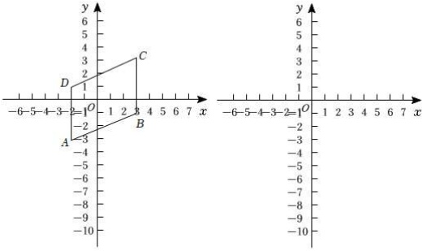

（8分）在平面直角坐标系 $xOy$ 中，$O(0,0)$，$A(-2,-3)$，$B(3,-1)$，$C(3,3)$，$D(-2,1)$，若点 $P$ 关于某直线 $l$ 的对称点落在平行四边形 $ABCD$ 内（不包含边界），则称点 $P$ 是平行四边形 $ABCD$ 的“$l\cdot$ 封闭点”。

（1）点 $P(1,2)$，若点 $P$ 是平行四边形 $ABCD$ 的“$l\cdot$ 封闭点”，则 $l$ 可以是 ___ 。（填序号）

$①$ $x$ 轴

$②$ $y$ 轴

$③$ 一三象限角平分线

$④$ 平行四边形 $ABCD$ 的对称轴

（2）若点 $Q$ 是平行四边形 $ABCD$ 的“$y$ 轴·封闭点”，求点 $Q$ 横坐标的取值范围；

（3）点 $M(0,-9)$，点 $N$ 是线段 $OM$ 上的一点，若点 $N$ 是平行四边形 $ABCD$ 的“直线 $y=-2$·封闭点”，求点 $N$ 的纵坐标的取值范围

> [!question]- 点击查看答案与解析
> 【答案】（1）$③$；（2）$-3 < q < 2$；（3）$-5.8 < y_N < -1.8$
> 
> 【考点】坐标对称 + 平行四边形封闭点新定义 → [[【初中数学知识点体系-人教版】#15-2 画轴对称的图形]]、[[【初中数学知识点体系-人教版】#21-1 平行四边形]]
> 
> 【解析】
> （1）先画平行四边形 $ABCD$：$A(-2,-3)$，$B(3,-1)$，$C(3,3)$，$D(-2,1)$。左右两边为竖直线 $x=-2$（$AD$）与 $x=3$（$BC$），上下两边 $AB$、$DC$ 的斜率均为 $\frac{2}{5}$：直线 $AB$：$y=-3+\frac{2}{5}(x+2)$，直线 $DC$：$y=1+\frac{2}{5}(x+2)$。判断点是否在内部，须与该 $x$ 处上下边界的截面比较，而非只看整体范围。
>   $P(1,2)$ 关于 $x$ 轴对称点为 $(1,-2)$：$x=1$ 处下边界 $y=-1.8$，$-2<-1.8$，在外部，$①$ 不符合；
>   关于 $y$ 轴对称点为 $(-1,2)$：$x=-1$ 处上边界 $y=1.4$，$2>1.4$，在外部，$②$ 不符合；
>   关于 $y=x$（一三象限角平分线）对称点为 $(2,1)$：$x=2$ 处截面 $y\in(-1.4,\,2.6)$，$1$ 在内部，$③$ 符合；
>   $④$：$AB$ 的水平、竖直位移为 $5$ 和 $2$，$BC$ 为 $0$ 和 $4$，邻边既不相等也不垂直，该平行四边形非菱形非矩形，没有对称轴（只有对称中心），"$l$ 是它的对称轴"无从谈起，$④$ 不符合。
>   故答案仅 $③$。
> （2）"$y$ 轴封闭点"即 $Q$ 关于 $y$ 轴对称点 $Q'(-q,y_Q)$ 落在 $ABCD$ 内，
>   $ABCD$ 横向范围 $x\in(-2,3)$，故 $-2 < -q < 3$，即 $-3 < q < 2$。
> （3）$N$ 在 $OM$ 上：$x=0$，$y_N\in[-9,0]$，关于直线 $y=-2$ 的对称点 $N'(0,-4-y_N)$。
>   $x=0$ 处平行四边形截面：下边界 $y=-3+\frac{2}{5}\times 2=-2.2$，上边界 $y=1+\frac{2}{5}\times 2=1.8$，
>   要求 $-2.2 < -4-y_N < 1.8$，解得 $-5.8 < y_N < -1.8$（自动满足 $y_N\in[-9,0]$）。
> 
> 验证（坐标截面自校验 6 项全部通过）：$(1,-2)$：$x=1$ 下界 $-1.8$，在其下方，外部 ✓（① 排除）；$(-1,2)$：$x=-1$ 上界 $1.4$，在其上方 ✓（② 排除）；$(2,1)$：截面 $(-1.4,2.6)$ 包含 $1$ ✓（③ 成立）；邻边位移 $(5,2)$ 与 $(0,4)$ 不等且点积 $8\neq 0$ 不垂直，非菱形非矩形、无对称轴 ✓（④ 排除）；$y_N=-3$（范围内）：$N'(0,-1)$ 在截面 $(-2.2,1.8)$ 内 ✓；$y_N=-6$（范围外）：$N'(0,2)$ 在截面上方，外部 ✓（边界 $-5.8$、$-1.8$ 精确吻合）。**修正说明**：原解析（1）中 ① 误判 $(1,-2)$ 在内部（未与 $x=1$ 处下边界 $-1.8$ 比较）、④ 虚构了"水平/垂直对称轴"（一般平行四边形无对称轴），正确仅 ③；（3）误用顶点纵坐标整体范围 $(-3,1)$ 作截面，实际 $x=0$ 处截面为 $(-2.2,1.8)$，答案由 $-5<y_N<-1$ 修正为 $-5.8<y_N<-1.8$。（2）的 $-3<q<2$ 正确。
> 
> 【易错点】一是新定义题先逐条翻译条件，将"在内部"转化为不等式组；二是判断点是否在平行四边形内部要用该竖直线处的上下边界截面，不能用整体 $x$ 或 $y$ 的范围；三是非菱形、非矩形的平行四边形没有对称轴，只有对称中心。
