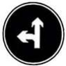
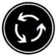
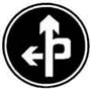

1. （2分）下列交通标志是轴对称图形的是（）

A.

B.

C.

D.

> [!question]- 点击查看答案与解析
> 【答案】B
> 
> 【考点】轴对称图形的识别 → [[【初中数学知识点体系-人教版】#15-1 图形的轴对称]]
> 
> 【解析】
> 判断依据：如果一个平面图形沿一条直线折叠，直线两旁的部分能够互相重合，这个图形就是轴对称图形。注意要把圆形外框与内部图案作为一个整体来判断。
> - 选项A：直行与左转组合标志，内部箭头一个向上、一个向左，分布不对称，找不到任何一条直线使折叠后两旁重合，不是轴对称图形；
> - 选项B：左右分向行驶标志，两个箭头分别指向左上、右上，关于经过圆心的竖直直线左右对称，沿这条直线折叠两旁能完全重合，是轴对称图形；
> - 选项C：环形（环岛）标志，三个箭头绕圆心旋转 $120^{\circ}$ 后能与自身重合，是旋转对称图形，但沿任何直线折叠两旁都不能重合，不是轴对称图形；
> - 选项D：直行、左转与绕行组合标志，图案明显不对称，不是轴对称图形。
> 综上，选 B。
> 
> 【易错点】把旋转对称图形误判为轴对称图形（选项C的环岛标志）；判断时只看圆形外框而忽略内部箭头图案，应把整个标志当作一个图形来检验。
