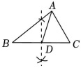
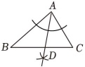
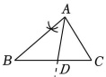
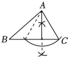

7. （2分）根据以下作图痕迹，能得到 $\triangle ABC$ 的角平分线 $AD$ 的是（）

A.

B.

C.

D.

> [!question]- 点击查看答案与解析
> 【答案】B
> 
> 【考点】角平分线的尺规作图 → [[【初中数学知识点体系-人教版】#14-3 角的平分线]]
> 
> 【解析】
> 作 $\angle BAC$ 平分线的标准痕迹：以顶点 $A$ 为圆心、适当长为半径画弧，分别交 $AB$、$AC$ 于两点；再分别以这两点为圆心、大于二者距离一半的长为半径画弧，两弧相交于一点；连接顶点 $A$ 与该交点的射线即 $\angle BAC$ 的平分线（其依据是 SSS 构造全等三角形）。
> - 选项A：作图痕迹是分别以 $A$、$B$ 为圆心画弧，交点连线为边 $AB$ 的垂直平分线，它与 $BC$ 的交点 $D$ 满足 $DA = DB$，得到的是"到线段两端点距离相等的点"，$AD$ 不是角平分线，错误；
> - 选项B：先以顶点 $A$ 为圆心画弧，交 $AB$、$AC$ 于两点，再以这两点为圆心画等弧相交于 $BC$ 下方一点，连接 $A$ 与该交点的射线交 $BC$ 于 $D$，正是 $\angle BAC$ 平分线的作法，能得到角平分线 $AD$，正确；
> - 选项C：弧线交点落在边 $AB$ 上，不符合"以顶点 $A$ 为圆心画弧交角的两边"的角平分线作法特征，不能推出 $\angle BAD = \angle CAD$，错误；
> - 选项D：以 $A$ 为圆心、足够长的半径画弧交直线 $BC$ 于两点，再以这两点为圆心画弧交于一点，连接 $A$ 与该点的直线垂直于 $BC$，这是过点 $A$ 作 $BC$ 的垂线（高线）的作法，$AD$ 是高而不是角平分线，错误。
> 综上，选 B。
> 
> 【易错点】混淆四种尺规痕迹的圆心位置：角平分线作法的第一条弧必须以角的顶点 $A$ 为圆心且与角的两边都相交；线段垂直平分线的弧以线段两端点为圆心；作高（过点作垂线）的弧以直线外一点为圆心且与直线交于两点。判断痕迹时先看弧的圆心在哪里。
