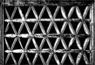
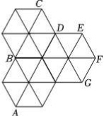

8. （2分）图1是一扇古建筑的窗棂，它的窗花格子由许多紧密连接的正三角形构成，图2是它的一部分．有以下三个结论：$①$ $\triangle ACD$ 和 $\triangle AED$ 全等；$②$ $\triangle ABC$ 和 $\triangle AFG$ 的面积相等；$③$ $\triangle AEF$ 是一个直角三角形，它的面积是 $\triangle ABC$ 面积的 1.5 倍．其中正确结论的个数是（）

图1

图2

A. 0

B. 1

C. 2

D. 3

> [!question]- 点击查看答案与解析
> 【答案】C
> 
> 【考点】三角形全等的判定（SAS）与格点三角形面积比较 → [[【初中数学知识点体系-人教版】#14-2 三角形全等的判定]]
> 
> 【解析】
> 设小正三角形的边长为 $1$，其高记为 $h$（相邻两平行格线间的距离都是 $h$）．
> - 结论 $①$：$CD=DE=1$（小三角形的边）．射线 $DA$ 沿格线斜方向向下，$DE$ 沿水平方向向右，二者夹角 $\angle ADE=180^\circ-60^\circ=120^\circ$；$DC$ 沿格线斜方向向上，与 $DA$ 的夹角 $\angle ADC=60^\circ+60^\circ=120^\circ$，故 $\angle ADC=\angle ADE$．又 $AD=AD$，所以 $\triangle ACD\cong\triangle AED$（SAS），$①$ 正确；
> - 结论 $②$：$AB$ 竖直，长 $2h$（$A$、$B$ 相隔两行格线），$C$ 到直线 $AB$ 的水平距离为 $1$，故 $S_{\triangle ABC}=\frac{1}{2}\times 2h\times 1=h$．$FG$ 是格线边，长 $1$，直线 $FG$ 与过 $A$ 的同族斜格线相隔 $2$ 行，即 $A$ 到 $FG$ 的距离为 $2h$，故 $S_{\triangle AFG}=\frac{1}{2}\times 1\times 2h=h$．两者面积相等，$②$ 正确；
> - 结论 $③$：$EF$ 是格线边，长 $1$，而 $A$ 到直线 $EF$ 相隔 $4$ 行格线，距离为 $4h$，故 $S_{\triangle AEF}=\frac{1}{2}\times 1\times 4h=2h=2S_{\triangle ABC}$，是 $\triangle ABC$ 面积的 $2$ 倍而不是 $1.5$ 倍，$③$ 错误．
> 综上，正确结论是 $①②$，共 2 个，选 C．
> 
> 【易错点】误以为 $\triangle AEF$ 与 $\triangle ABC$ 的面积比是 1.5 倍——用格线数"行高"比较面积时，要选好底边（格线边）并数清底到对应顶点之间隔几行格线。
