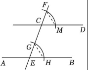

10. （2分）下面是“过直线AB外一点 C 作直线 AB 的平行线”的尺规作图方法.

（1）如图，过点 C 作一条直线，与直线 AB 相交于点E；

（2）在点 C 处作 $\angle CEB$ 的同位角 $\angle FCD$，使 $\angle FCD=\angle CEB$；

（3）反向延长 CD，得到直线 CD，则直线 CD $∥$ AB.

上述方法通过判定 $\triangle FCM\cong\triangle GEH$ 得到 $\angle FCD=\angle CEB$，其中判定 $\triangle FCM\cong\triangle GEH$ 的依据是 ___ 。

> [!question]- 点击查看答案与解析
> 【答案】SSS（三边分别相等的两个三角形全等）
> 
> 【考点】作一个角等于已知角的原理——三角形全等的判定（SSS） → [[【初中数学知识点体系-人教版】#14-2 三角形全等的判定]]
> 
> 【解析】
> 由作图痕迹可知：
> - 以点 $E$ 为圆心、某一长为半径画弧，分别交 $EC$、$EB$ 于点 $G$、$H$，故 $EG=EH$；
> - 以点 $C$ 为圆心、同样长为半径画弧，分别交 $CF$、$CD$ 于点 $F$、$M$，故 $CF=CM=EG=EH$；
> - 再以点 $F$ 为圆心、$GH$ 长为半径画弧确定点 $M$，故 $FM=GH$．
> 于是在 $\triangle FCM$ 与 $\triangle GEH$ 中，$FC=GE$，$CM=EH$，$FM=GH$，三边分别相等，依据"SSS"判定 $\triangle FCM\cong\triangle GEH$，从而 $\angle FCM=\angle GEH$，即 $\angle FCD=\angle CEB$；再由"同位角相等，两直线平行"得 $CD\parallel AB$．
> 
> 【易错点】误答成 SAS——作图痕迹中相等的量是三条线段（两个半径和一段弦长），并没有直接给出任何角相等，角相等恰恰是全等的结论。
