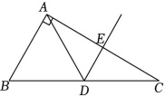

11. （2分）如图，在 $\triangle ABC$ 中，$\angle BAC=90^\circ$，$AB=6$。$AD$ 是 $\triangle ABC$ 的中线，过点 $D$ 作 $DE\parallel AB$，交 $AC$ 于点 $E$。若 $\triangle ABC$ 的面积是24，则线段 $DE$ 的长是 ___ 。

> [!question]- 点击查看答案与解析
> 【答案】3
> 
> 【考点】三角形中线的性质（中线等分面积）→ [[【初中数学知识点体系-人教版】#13-2 与三角形有关的线段]]；平行线的性质（垂直于平行线中一条必垂直于另一条）→ [[【初中数学知识点体系-人教版】#7-2 平行线]]
> 
> 【解析】
> - 由 $\angle BAC=90^\circ$ 知 $AB$、$AC$ 是 $\triangle ABC$ 的两条直角边，$S_{\triangle ABC}=\frac{1}{2}AB\cdot AC=\frac{1}{2}\times 6\times AC=24$，解得 $AC=8$．
> - $AD$ 是 $BC$ 边上的中线，则 $D$ 是 $BC$ 的中点，$BD=DC$．$\triangle ABD$ 与 $\triangle ACD$ 等底（$BD=DC$）同高（都是点 $A$ 到 $BC$ 的距离），所以 $S_{\triangle ACD}=\frac{1}{2}S_{\triangle ABC}=12$．
> - 因为 $DE\parallel AB$ 且 $AB\perp AC$，所以 $DE\perp AC$，即 $DE$ 恰是 $\triangle ACD$ 中边 $AC$ 上的高．
> - 于是 $S_{\triangle ACD}=\frac{1}{2}AC\cdot DE$，即 $12=\frac{1}{2}\times 8\times DE$，解得 $DE=3$．
> 
> 【易错点】本题不能直接用"中位线"结论（中位线定理是八下内容），应通过"中线等分面积＋把 DE 看作 △ACD 的高"的面积法求解；另外求 $AC$ 时别把面积公式中的 $\frac{1}{2}$ 漏掉。
