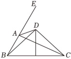
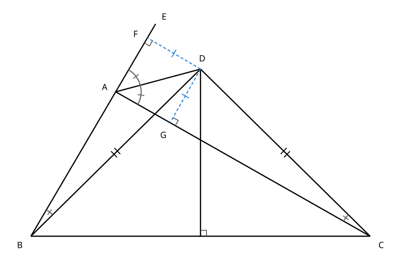

14. （2分）如图，在 $\triangle ABC$ 中，$\angle BAC=\alpha$，点 $D$ 是 $\triangle ABC$ 的外角 $\angle EAC$ 的平分线和边 $BC$ 的垂直平分线的交点，则 $\angle DCB=$ ___ （用含有 $\alpha$ 的式子表示）。

> [!question]- 点击查看答案与解析
> 【答案】$90^\circ-\dfrac{1}{2}\alpha$
> 
> 【考点】角平分线的性质与线段垂直平分线的性质，结合 HL 构造全等 → [[【初中数学知识点体系-人教版】#14-3 角的平分线]]；垂直平分线上的点到两端点距离相等 → [[【初中数学知识点体系-人教版】#15-1 图形的轴对称]]；直角三角形全等的判定（HL）→ [[【初中数学知识点体系-人教版】#14-2 三角形全等的判定]]
> 
> 【解析】
> 连接 $DB$、$DC$（如图），作 $DF\perp AB$ 交 $BA$ 的延长线于点 $F$，作 $DG\perp AC$ 于点 $G$。
> - 因为 $AD$ 平分外角 $\angle EAC$，$DF\perp AE$，$DG\perp AC$，由角平分线的性质得 $DF=DG$；
> - 因为点 $D$ 在边 $BC$ 的垂直平分线上，所以 $DB=DC$，从而 $\angle DBC=\angle DCB$。
> 在 $\mathrm{Rt}\triangle DFB$ 与 $\mathrm{Rt}\triangle DGC$ 中，$DB=DC$（斜边），$DF=DG$（直角边），
> 所以 $\mathrm{Rt}\triangle DFB\cong\mathrm{Rt}\triangle DGC$（HL），得 $\angle DBF=\angle DCG$，即 $\angle DBA=\angle DCA$。
> 按图中位置做角的和差：$\angle ABC=\angle DBA+\angle DBC$，$\angle ACB=\angle DCB-\angle DCA$，
> 两式相加，$\angle DBA$ 与 $-\angle DCA$ 抵消，且 $\angle DBC=\angle DCB$，得
> $\angle ABC+\angle ACB=2\angle DCB$。
> 又在 $\triangle ABC$ 中 $\angle BAC+\angle ABC+\angle ACB=180^\circ$，即 $\alpha+2\angle DCB=180^\circ$，
> 所以 $\angle DCB=90^\circ-\dfrac{1}{2}\alpha$。
> 
> 
> 
> 【易错点】见到"角平分线＋垂直平分线"就要想到过 $D$ 向 $\angle EAC$ 的两边作垂线构造全等；漏掉"到角两边距离相等"必须先作垂直才能使用；另外 $\angle ACB=\angle DCB-\angle DCA$ 的和差方向要结合图形写对，不要弄反。
