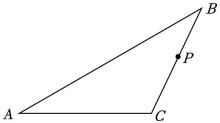
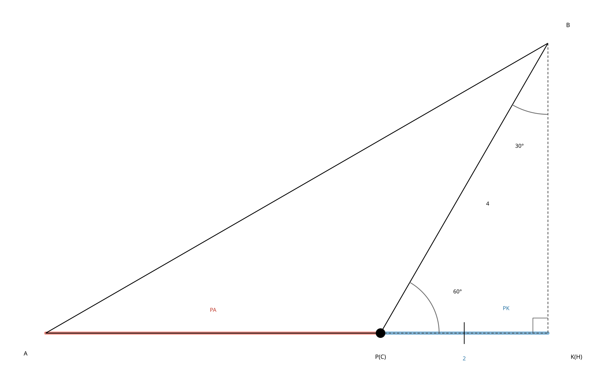

15. （2分）如图，在 $\triangle ABC$ 中，$\angle ACB=120^\circ$，$AC=BC=4$，若 P 是直线 BC 上的动点，则 $PA + \frac{1}{2} PB$ 的最小值是 ___ 。

> [!question]- 点击查看答案与解析
> 【答案】$6$
> 
> 【考点】含 $30^\circ$ 角的直角三角形性质 → [[【初中数学知识点体系-人教版】#15-3 等腰三角形]]，垂线段最短 → [[【初中数学知识点体系-人教版】#7-1 相交线]]
> 
> 【解析】
> 由 $AC=BC$，$\angle ACB=120^\circ$，得 $\angle ABC=\angle BAC=\frac{180^\circ-120^\circ}{2}=30^\circ$。
> 延长 $AC$，过点 B 作 $BH\perp AC$ 于点 H（H 在 $AC$ 的延长线上）。因为 $\angle ACB=120^\circ$，所以 $\angle BCH=180^\circ-120^\circ=60^\circ$，在 Rt$\triangle BCH$ 中 $\angle CBH=30^\circ$，于是 $CH=\frac{1}{2}BC=2$（在直角三角形中，$30^\circ$ 角所对的直角边等于斜边的一半）。
> 对直线 BC 上任意一点 P，过 P 作 $PK\perp BH$ 于 K。因为直线 BC 与直线 BH 的夹角 $\angle CBH=30^\circ$，在 Rt$\triangle PBK$ 中 $PK=\frac{1}{2}PB$。
> 于是 $PA+\frac{1}{2}PB=PA+PK$，它表示从点 A 经 P 再到直线 BH 的一条折线。而 $AH\perp BH$，由"垂线段最短"，对直线 BH 而言从 A 出发的折线长不小于垂线段 $AH$，即 $PA+PK\geq AH$。
> 当 P 运动到与 C 重合时，A、P、K 三点共线（K 与 H 重合），等号成立。
> 所以最小值为 $AH=AC+CH=4+2=6$。
> 
> 
> 
> 【易错点】一是忽视 P 在"直线 BC"上可运动到与点 C 重合（取等位置恰为 $P=C$）；二是转化 $\frac{1}{2}PB$ 时误用"$30^\circ$ 角相邻的直角边"，应是 $30^\circ$ 角所对的直角边等于斜边的一半。
