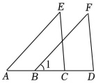

18. （5分）如图，在 $\triangle ACE$ 和 $\triangle BDF$ 中，点 $A,B,C,D$ 在同一条直线上，$\angle A=\angle1$，$CE\parallel DF$，$AB=CD$．求证：$CE=DF$．

> [!question]- 点击查看答案与解析
> 【答案】见解析（$\triangle ACE\cong\triangle BDF$，ASA，得 $CE=DF$）
> 
> 【考点】三角形全等的判定（ASA）→ [[【初中数学知识点体系-人教版】#14-2 三角形全等的判定]]，平行线的性质（同位角相等）→ [[【初中数学知识点体系-人教版】#7-2 平行线]]
> 
> 【解析】
> 证明：因为 $AB=CD$，所以 $AB+BC=CD+BC$，即 $AC=BD$。
> 因为 $CE\parallel DF$（$\angle ACE$ 与 $\angle BDF$ 是直线 CE、DF 被直线 AD 所截形成的同位角），所以 $\angle ACE=\angle BDF$。
> 在 $\triangle ACE$ 和 $\triangle BDF$ 中：
> $\angle A=\angle1$（已知，即 $\angle CAE=\angle DBF$），
> $AC=BD$（已证），
> $\angle ACE=\angle BDF$（已证），
> 所以 $\triangle ACE\cong\triangle BDF$（ASA）。
> 所以 $CE=DF$（全等三角形的对应边相等）。
> 
> 【易错点】一是由 $AB=CD$ 推 $AC=BD$ 时漏加公共段 BC，直接拿 AB、CD 当三角形的边；二是找角时把 $\angle ACE$ 错认成 $\angle ECB$（应为射线 CA 方向与 CE 的夹角），对应顶点顺序 A↔B、C↔D、E↔F 写乱导致 ASA 条件对不上。
