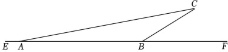

19. （5分）如图，已知直线 $EF$ 和 $\triangle ABC$，点 $A$，$B$ 在直线 $EF$ 上.

（1）尺规作图（保留作图痕迹，不写作法）；

$①$ 过点 $C$ 作直线 $EF$ 的垂线，垂足为点 $G$；

$②$ 作点 $C$ 关于直线 $EF$ 的对称点 $C_{1}$;

（2）若点 $C$ 到直线 $EF$ 的距离为 1， $\angle CBF=30^{\circ}$，求线段 $BC$ 的长；

（3）在（2）的条件下，若 $AB=2BC$，求 $\triangle ABC_{1}$ 的面积.

> [!question]- 点击查看答案与解析
> 【答案】(1) 作图痕迹见解析；(2) $BC=2$；(3) $S_{\triangle ABC_{1}}=2$
> 
> 【考点】过一点作已知直线的垂线、作对称点（画轴对称图形）→ [[【初中数学知识点体系-人教版】#15-2 画轴对称的图形]]，含 $30^\circ$ 角的直角三角形性质 → [[【初中数学知识点体系-人教版】#15-3 等腰三角形]]
> 
> 【解析】
> (1) $①$ 以点 C 为圆心、适当长为半径画弧，交直线 EF 于两点；再分别以这两点为圆心、大于两点间距离的一半为半径画弧，两弧在 EF 下方交于一点，过该点与 C 作直线，交 EF 于垂足 G，则 $CG\perp EF$。$②$ 沿 $CG$ 方向延长，在射线上截取 $GC_{1}=GC$，则 $CC_{1}$ 被 EF 垂直平分，点 $C_{1}$ 即点 C 关于直线 EF 的对称点。
> (2) 点 $C$ 到 $EF$ 的距离即 $CG=1$。因 $CG\perp EF$，G 在射线 BF 上，故 $\angle CBG=\angle CBF=30^\circ$。在 Rt$\triangle CGB$ 中，$30^\circ$ 角所对的直角边等于斜边的一半，所以 $BC=2CG=2$。
> (3) 由对称性，$GC_{1}=GC=1$，即点 $C_{1}$ 到直线 EF 的距离为 1。又 $AB=2BC=4$，且 A、B 都在直线 EF 上，以 AB 为底、$C_{1}$ 到 AB 所在直线的距离 GC₁ 为高：
> $S_{\triangle ABC_{1}}=\frac{1}{2}\cdot AB\cdot GC_{1}=\frac{1}{2}\times4\times1=2$。
> 
> 【易错点】作垂线时第二次画弧的半径必须"大于两交点间距离的一半"，否则两弧不相交；求面积时易误以为 $C_{1}$ 到 EF 的距离与 C 不同——轴对称保证 $GC_{1}=GC=1$，高仍是 1 而不是 2。
