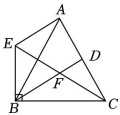

20. （5分）如图，$\triangle ABC$ 是等边三角形，$D$ 是 $AC$ 的中点，$BE⊥BC$，$AE∥BD$，$CE$ 交 $BD$ 于点 $F$.

（1）求 $\angle BAE$ 的大小；

（2）判断 $\triangle BEF$ 的形状，并证明.

> [!question]- 点击查看答案与解析
> 【答案】(1) $\angle BAE=30^\circ$；(2) $\triangle BEF$ 是等边三角形
> 
> 【考点】等边三角形的性质与判定、等角对等边 → [[【初中数学知识点体系-人教版】#15-3 等腰三角形]]，直角三角形全等的判定（HL）→ [[【初中数学知识点体系-人教版】#14-2 三角形全等的判定]]，平行线的性质 → [[【初中数学知识点体系-人教版】#7-2 平行线]]
> 
> 【解析】
> (1) 因为 $\triangle ABC$ 是等边三角形，D 是 AC 的中点，由等腰三角形"三线合一"得 $BD\perp AC$，即 $\angle BDC=90^\circ$。
> 因为 $AE\parallel BD$，所以 $\angle EAC=\angle BDC=90^\circ$（两直线平行，同位角相等，即 AE 也垂直于 AC）。
> 所以 $\angle BAE=\angle EAC-\angle BAC=90^\circ-60^\circ=30^\circ$。
> (2) 结论：$\triangle BEF$ 是等边三角形。证明如下：
> 因为 $BE\perp BC$，所以 $\angle EBC=90^\circ$，于是 $\angle ABE=\angle EBC-\angle ABC=90^\circ-60^\circ=30^\circ=\angle BAE$，
> 由"等角对等边"得 $EA=EB$。
> 在 Rt$\triangle EAC$ 和 Rt$\triangle EBC$ 中：$\angle EAC=\angle EBC=90^\circ$，$EA=EB$（直角边），$EC=EC$（公共斜边），
> 所以 Rt$\triangle EAC\cong$ Rt$\triangle EBC$（HL），
> 所以 $\angle ACE=\angle BCE=\frac{1}{2}\angle ACB=30^\circ$，$\angle AEC=\angle BEC$。
> 在 Rt$\triangle EBC$ 中，$\angle BEC=90^\circ-\angle BCE=90^\circ-30^\circ=60^\circ$，即 $\angle BEF=60^\circ$。
> 又 BD 平分 $\angle ABC$（三线合一），$\angle DBC=30^\circ$，所以 $\angle EBF=\angle EBC-\angle DBC=90^\circ-30^\circ=60^\circ$。
> 在 $\triangle BEF$ 中，$\angle BFE=180^\circ-\angle BEF-\angle EBF=60^\circ$，三个内角都是 $60^\circ$，
> 所以 $\triangle BEF$ 是等边三角形。
> 
> 【易错点】一是漏用"三线合一"，得不到 $BD\perp AC$ 与 $\angle DBC=30^\circ$；二是证全等时误用"SSA"，必须先由 $\angle EAC=\angle EBC=90^\circ$ 确认是直角三角形后用 HL；三是求 $\angle ABE$ 时误算成 $\angle EBC+\angle ABC$，注意射线 BA 在 $\angle EBC$ 内部。
