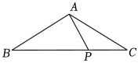

22. （5分）如图，在 $\triangle ABC$ 中，$AB=AC$，$\angle B=30^{\circ}$，$P$ 为边 $BC$ 上的一点（点 $P$ 不与点 $B$，$C$ 重合），连接 $AP$，$\triangle APC$ 的两个内角的差恰好为 $90^{\circ}$。

（1）求 $\angle BAP$ 的度数；

（2）若 $AP=n$，求 $BC$ 的长（用含有 $n$ 的式子表示）.

> [!question]- 点击查看答案与解析
> 【答案】（1）$\angle BAP=90^{\circ}$；（2）$BC=3n$
> 
> 【考点】三角形内角和与分类讨论 → [[【初中数学知识点体系-人教版】#13-3 三角形的内角与外角]]、等腰三角形性质及含 $30^{\circ}$ 角的直角三角形的性质 → [[【初中数学知识点体系-人教版】#15-3 等腰三角形]]
> 
> 【解析】
> （1）由 $AB=AC$，$\angle B=30^{\circ}$，得 $\angle C=\angle B=30^{\circ}$，$\angle BAC=120^{\circ}$。$\triangle APC$ 的三个内角为 $\angle APC$、$\angle PAC$、$\angle C=30^{\circ}$，且 $\angle APC+\angle PAC=180^{\circ}-30^{\circ}=150^{\circ}$。按“两个内角的差为 $90^{\circ}$”分类：
> $①$ 若 $\angle APC-\angle PAC=90^{\circ}$，联立 $\angle APC+\angle PAC=150^{\circ}$，得 $\angle APC=120^{\circ}$，$\angle PAC=30^{\circ}$；
> $②$ 若 $\angle PAC-\angle APC=90^{\circ}$，得 $\angle PAC=120^{\circ}$，$\angle APC=30^{\circ}$，此时 $\angle APB=180^{\circ}-\angle APC=150^{\circ}$，在 $\triangle ABP$ 中 $\angle B+\angle APB=180^{\circ}$，三角形不存在（点 $P$ 与 $B$ 重合），舍去；
> $③$ 若差为 $90^{\circ}$ 的两角中含 $\angle C=30^{\circ}$：$\angle APC-\angle C=90^{\circ}$ 得 $\angle APC=120^{\circ}$（同 $①$）；$\angle PAC-\angle C=90^{\circ}$ 得 $\angle PAC=120^{\circ}$（同 $②$，舍去）。
> 故 $\angle APC=120^{\circ}$，$\angle APB=60^{\circ}$，在 $\triangle ABP$ 中 $\angle BAP=180^{\circ}-\angle B-\angle APB=180^{\circ}-30^{\circ}-60^{\circ}=90^{\circ}$。
> （2）在 $\triangle ABP$ 中，$\angle BAP=90^{\circ}$，$\angle B=30^{\circ}$，由“直角三角形中 $30^{\circ}$ 角所对的直角边等于斜边的一半”（$AP$ 是 $30^{\circ}$ 角 $\angle B$ 所对的边，斜边为 $BP$）得 $BP=2AP=2n$。又 $\angle PAC=30^{\circ}=\angle C$，由等角对等边得 $PC=AP=n$。所以 $BC=BP+PC=2n+n=3n$。
> 
> 【易错点】分类讨论时漏掉 $\angle PAC-\angle APC=90^{\circ}$ 的情形或忘记检验其退化（点 $P$ 与 $B$ 重合）而舍去；把含 $30^{\circ}$ 直角三角形的“一半”关系用错边（应为 $30^{\circ}$ 角所对的直角边 $AP$ 等于斜边 $BP$ 的一半，即 $BP=2n$）。
