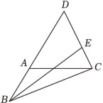
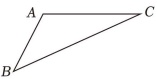
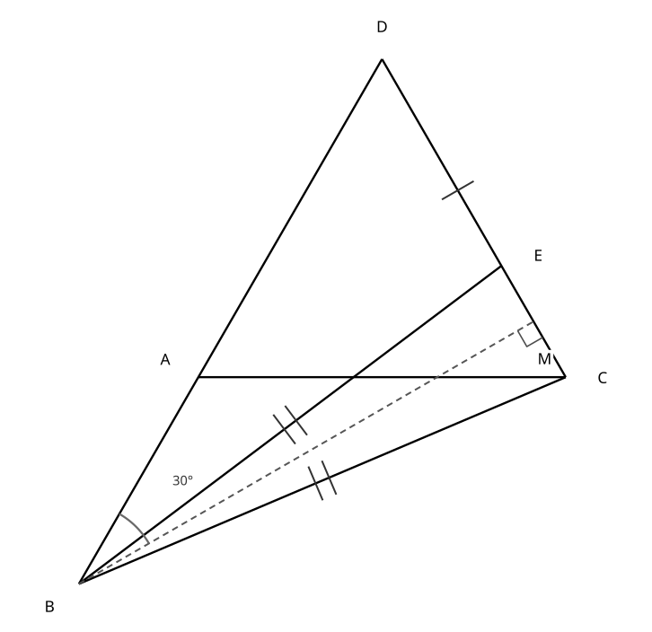
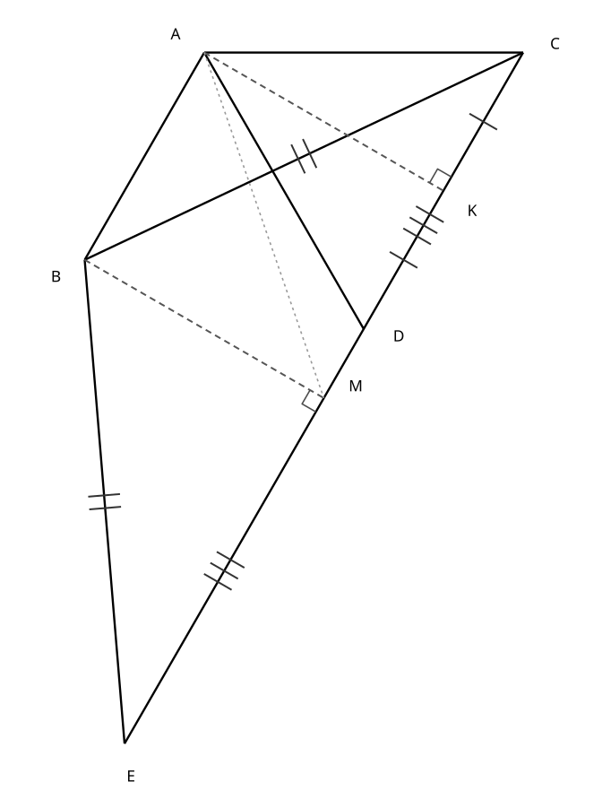

25. （7分）在 $\triangle ABC$ 中，$\angle BAC=120^\circ$，$\triangle ACD$ 是等边三角形，点 $E$ 在直线 $CD$ 上，且 $BE=BC$。

图1

图2

（1）如图1，点 $D$ 在 $AC$ 的上方.

$①$ 求证： $\angle ACB = \angle DBE$;

$②$ 用等式表示线段 $AB$，$AC$，$CE$ 的数量关系，并证明；

（2）点 $D$ 在 $AC$ 的下方，在图2中补全图形，直接用等式表示线段 $AB$，$AC$，$CE$ 的数量关系.

> [!question]- 点击查看答案与解析
> 【答案】（1）$①$ 见解析；$②$ $AB+CE=AC$；（2）$CE=AC+2AB$
> 
> 【考点】等腰、等边三角形性质（三线合一、含 $30^{\circ}$ 角的直角三角形）→ [[【初中数学知识点体系-人教版】#15-3 等腰三角形]]、三角形内角和与外角 → [[【初中数学知识点体系-人教版】#13-3 三角形的内角与外角]]、三角形全等的判定 → [[【初中数学知识点体系-人教版】#14-2 三角形全等的判定]]、平行线的判定与性质 → [[【初中数学知识点体系-人教版】#7-2 平行线]]
> 
> 【解析】
> （1）$①$ 因为 $\triangle ACD$ 是等边三角形，所以 $\angle DAC=\angle ACD=\angle ADC=60^{\circ}$。又 $\angle BAC=120^{\circ}$，所以 $\angle BAC+\angle DAC=180^{\circ}$，即 $B$、$A$、$D$ 三点共线，且 $\angle BDE=\angle ADC=60^{\circ}$。因为 $BE=BC$，所以 $\angle BEC=\angle BCE=\angle BCA+\angle ACD=\angle BCA+60^{\circ}$。因为点 $E$ 在线段 $DC$ 上，$\angle DEB=180^{\circ}-\angle BEC$。在 $\triangle BDE$ 中，$\angle DBE=180^{\circ}-\angle BDE-\angle DEB=180^{\circ}-60^{\circ}-(180^{\circ}-\angle BEC)=\angle BEC-60^{\circ}=\angle BCA$，即 $\angle ACB=\angle DBE$。
> $②$ 数量关系：$AB+CE=AC$。证明：过 $B$ 作 $BM\perp CD$ 于点 $M$（辅助线，$M$ 在线段 $CE$ 上）。因为 $BE=BC$ 且 $BM\perp EC$，由等腰三角形三线合一，$M$ 是 $EC$ 的中点，$CM=\frac{1}{2}CE$。在 $Rt\triangle BDM$ 中，$\angle BDM=\angle BDC=60^{\circ}$，所以 $\angle DBM=30^{\circ}$，由“含 $30^{\circ}$ 角的直角三角形中，$30^{\circ}$ 角所对的直角边等于斜边的一半”得 $DM=\frac{1}{2}BD$。由 $B$、$A$、$D$ 共线得 $BD=AB+AD=AB+AC$；又 $DM=DC-CM=AC-\frac{1}{2}CE$。所以 $AB+AC=2\left(AC-\frac{1}{2}CE\right)=2AC-CE$，整理得 $AB+CE=AC$。
> 
> 
> 
> （2）补全图形：以 $AC$ 为边在 $AC$ 下方作等边 $\triangle ACD$（$D$ 在 $AC$ 下方，此时射线 $AD$ 落在 $\angle BAC$ 内部），连接 $AD$、$DC$ 并沿 $C$ 到 $D$ 的方向延长 $CD$ 至点 $E$（$E$ 在 $CD$ 的延长线上、$D$ 的外侧），使 $BE=BC$，连接 $BE$。数量关系：$CE=AC+2AB$。理由：因为 $\angle BAC=120^{\circ}$，$\angle ACD=60^{\circ}$，所以 $\angle BAC+\angle ACD=180^{\circ}$，得 $AB\parallel CD$。过 $A$ 作 $AK\perp CD$ 于 $K$，过 $B$ 作 $BM\perp CE$ 于 $M$。由等边三角形三线合一，$K$ 是 $CD$ 中点，$CK=\frac{1}{2}CD=\frac{1}{2}AC$；由 $BE=BC$、$BM\perp CE$ 得 $M$ 是 $CE$ 中点，$CM=\frac{1}{2}CE$。因 $AB\parallel CD$ 且 $AK$、$BM$ 都垂直于直线 $CD$，故 $\angle KAB=\angle ABM=90^{\circ}$；连接 $AM$，在 $\triangle ABM$ 与 $\triangle MKA$ 中，$\angle ABM=\angle MKA=90^{\circ}$，$\angle BAM=\angle KMA$（$AB\parallel CD$，内错角），$AM=MA$，所以 $\triangle ABM\cong\triangle MKA$（$AAS$），得 $KM=AB$。又 $KM=CM-CK=\frac{1}{2}CE-\frac{1}{2}AC$，所以 $AB=\frac{1}{2}(CE-AC)$，即 $CE=AC+2AB$。
> 
> 
> 
> 【易错点】（1）$①$ 中漏掉关键结论“$B$、$A$、$D$ 共线”（由 $\angle BAC+\angle CAD=180^{\circ}$ 得出），导致 $\angle BDE=60^{\circ}$ 与 $BD=AB+AC$ 无从使用；（1）$②$ 中把 $DM$ 与 $CM$ 的位置关系弄错（应为 $DM=DC-CM$）；（2）中直接照搬（1）的结论写成 $CE=AC-AB$，未注意此时 $AB\parallel CD$ 且点 $E$ 落在 $CD$ 的延长线上，关系变为 $CE=AC+2AB$。
