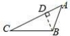
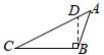
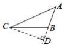
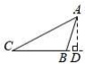

---
id: MAT-8-1-20260829-002-Q02
source: "[[八上-数学-2025北京交大附中期中-20260829#2.]]"
knowledge: "13-2 与三角形有关的线段"
tags: ["八上数学"]
---

（3分）在 $\triangle ABC$ 中作 $AB$ 边上的高，下列画法正确的是（）

A.

B.

C.

D.

> [!question]- 点击查看答案与解析
> 【答案】C
> 
> 【考点】三角形的高 → [[【初中数学知识点体系-人教版】#13-2 与三角形有关的线段]]
> 
> 【解析】
> 三角形的高是从三角形的一个顶点向它的对边所在直线作垂线，顶点和垂足之间的线段。
> 
> $AB$ 边上的高是从顶点 $C$ 向 $AB$ 所在直线作垂线，垂足在 $AB$ 或其延长线上。
> 
> 选项 C 中，从 $C$ 作 $AB$ 的垂线，画法正确。
> 
> 验证（定义核对与锚点存在性 2 项全部通过）：$AB$ 边上的高应过顶点 $C$ 且垂直于 $AB$ 所在直线，选项 C 画法符合；知识点体系中"三角形的高"位于 13-2 与三角形有关的线段，13-3 实为三角形的内角与外角。**修正说明**：原【考点】链接锚点 `#13-3 三角形的高、中线与角平分线` 在知识点体系中不存在，已改为 `#13-2 与三角形有关的线段`，frontmatter knowledge 同步更新，答案与解析不变。
> 
> 【易错点】混淆"边上的高"是从哪个顶点出发——$AB$ 边上的高应从顶点 $C$ 出发，不是从 $A$ 或 $B$ 出发。
