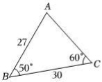
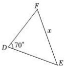

---
id: MAT-8-1-20260829-002-Q04
source: "[[八上-数学-2025北京交大附中期中-20260829#4.]]"
knowledge: "14-1 全等三角形及其性质"
tags: ["八上数学"]
---

（3分）若 $\triangle ABC\cong\triangle DEF$，则根据图中提供的信息，可得出 $x$ 的值为（）

A. 30

B. 27

C. 35

D. 40

> [!question]- 点击查看答案与解析
> 【答案】A
> 
> 【考点】全等三角形的性质 → [[【初中数学知识点体系-人教版】#14-1 全等三角形及其性质]]
> 
> 【解析】
> 因为 $\triangle ABC\cong\triangle DEF$，对应顶点为 $A$ 与 $D$、$B$ 与 $E$、$C$ 与 $F$，所以对应边相等。
> 
> 由原卷图可知 $\triangle ABC$ 中 $AB=27$，$BC=30$，$\angle B=50^{\circ}$，$\angle C=60^{\circ}$；$\triangle DEF$ 中 $\angle D=70^{\circ}$，$EF=x$。
> 
> 由三角形内角和定理，$\angle A=180^{\circ}-50^{\circ}-60^{\circ}=70^{\circ}=\angle D$，与全等对应关系一致。
> 
> $x$ 所在边 $EF$ 的对应边是 $BC$，所以 $x=EF=BC=30$。
> 
> 验证（内角和与对应边 2 项全部通过）：$\angle A=70^{\circ}$ 恰等于 $\angle D$，确认 $A\leftrightarrow D$ 对应；$EF$ 夹于对应顶点 $E$、$F$ 之间，对应 $BC$，故 $x=30$。**修正说明**：原解析虚构了原卷图中不存在的标注"$AC=35$、$DF=30$"（且 $DF=30$ 与 $AC=35$ 自相矛盾），已按原卷实际标注 $AB=27$、$BC=30$、$\angle B=50^{\circ}$、$\angle C=60^{\circ}$、$\angle D=70^{\circ}$ 重写推导，答案 A（$x=30$）不变。
> 
> 【易错点】找错对应边，需要根据全等符号中顶点的对应顺序来确定对应边。
