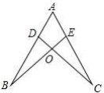

---
id: MAT-8-1-20260829-002-Q05
source: "[[八上-数学-2025北京交大附中期中-20260829#5.]]"
knowledge: "14-2 三角形全等的判定"
tags: ["八上数学"]
---

（3分）如图，点 $D$，$E$ 分别在线段 $AB$，$AC$ 上，$CD$ 与 $BE$ 相交于 $O$ 点，已知 $AB=AC$，现添加以下的哪个条件仍不能判定 $\triangle ABE\cong\triangle ACD$（）

A. $\angle B=\angle C$

B. $AD=AE$

C. $BD=CE$

D. $BE=CD$

> [!question]- 点击查看答案与解析
> 【答案】D
> 
> 【考点】全等三角形的判定 → [[【初中数学知识点体系-人教版】#14-2 三角形全等的判定]]
> 
> 【解析】
> 已知 $AB=AC$，$\angle A=\angle A$（公共角），$\triangle ABE$ 和 $\triangle ACD$ 已有一边一角相等。
> 
> A. $\angle B=\angle C$，则 $AB=AC$，$\angle A=\angle A$，$\angle B=\angle C$，可用 ASA 判定全等；
> B. $AD=AE$，则 $AB=AC$，$\angle A=\angle A$，$AE=AD$，可用 SAS 判定全等；
> C. $BD=CE$，因为 $AB=AC$，所以 $AD=AB-BD=AC-CE=AE$，回到 B 的情形，可用 SAS 判定全等；
> D. $BE=CD$，此时两边及其中一边的对角对应相等（SSA），不能判定全等。
> 
> 【易错点】SSA 不能判定三角形全等，这是常见的判定误区。
