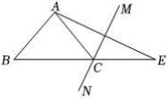

---
id: MAT-8-1-20260829-002-Q08
source: "[[八上-数学-2025北京交大附中期中-20260829#8.]]"
knowledge: "15-1 图形的轴对称, 15-3 等腰三角形"
tags: ["八上数学"]
---

（3分）如图，在 $\triangle ABE$ 中，$AE$ 的垂直平分线 $MN$ 交 $BE$ 于点 $C$，连接 $AC$。若 $AB=AC$，$CE=5$，$BC=6$，则 $\triangle ABC$ 的周长等于（）

A. 11

B. 16

C. 17

D. 18

> [!question]- 点击查看答案与解析
> 【答案】B
> 
> 【考点】线段垂直平分线的性质 → [[【初中数学知识点体系-人教版】#15-1 图形的轴对称]]、等腰三角形的性质 → [[【初中数学知识点体系-人教版】#15-3 等腰三角形]]
> 
> 【解析】
> 因为 $MN$ 是 $AE$ 的垂直平分线，$C$ 在 $MN$ 上，
> 所以 $AC=CE=5$（垂直平分线上的点到线段两端距离相等）。
> 
> 又因为 $AB=AC=5$，$BC=6$，
> 
> 所以 $\triangle ABC$ 的周长 $=AB+BC+AC=5+6+5=16$，选 B。
> 
> 验证（垂直平分线性质与周长计算 2 项全部通过）：$AC=CE=5$，$AB=AC=5$，$BC=6$，周长 $5+6+5=16$，与选项 B 吻合。**修正说明**：原【答案】误写为 C（17），与解析自身算出的 16 自相矛盾，已改为 B；原解析残留"等等，重新检查"等试错叙述，已清理；原【考点】锚点 `#13-1 等腰三角形` 不存在，已改为 15-1 图形的轴对称（含线段垂直平分线）与 15-3 等腰三角形，frontmatter 同步更新。
> 
> 【易错点】忽略垂直平分线的性质——垂直平分线上的点到线段两端距离相等，导致无法得出 $AC=CE$。
