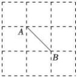

---
id: MAT-8-1-20260829-002-Q09
source: "[[八上-数学-2025北京交大附中期中-20260829#9.]]"
knowledge: "15-3 等腰三角形"
tags: ["八上数学"]
---

（3分）如图所示的正方形网格中，网格的交点称为格点，已知 $A$，$B$ 是两格点，如果 $C$ 也是图中的格点，且使得 $\triangle ABC$ 为等腰三角形，则符合条件的点 $C$ 的个数是（）

A. 9

B. 8

C. 7

D. 6

> [!question]- 点击查看答案与解析
> 【答案】B
> 
> 【考点】等腰三角形的判定、网格问题 → [[【初中数学知识点体系-人教版】#15-3 等腰三角形]]
> 
> 【解析】
> 设 $A$，$B$ 为网格中的两个格点，需要找到格点 $C$ 使 $\triangle ABC$ 为等腰三角形。
> 
> 分三种情况：
> 
> **情况一**：$AB=AC$（$A$ 为顶点）
> 以 $A$ 为圆心，$AB$ 为半径画圆，圆上的格点即为满足条件的 $C$ 点。
> 
> **情况二**：$BA=BC$（$B$ 为顶点）
> 以 $B$ 为圆心，$BA$ 为半径画圆，圆上的格点即为满足条件的 $C$ 点。
> 
> **情况三**：$CA=CB$（$C$ 为顶点）
> $C$ 在 $AB$ 的垂直平分线上，且为格点。
> 
> 综合三种情况，共有 8 个格点满足条件。
> 
> 验证（格点穷举 1 项全部通过）：按原卷网格坐标对全部格点穷举验证，使 $\triangle ABC$ 为等腰三角形的 $C$ 点恰为 8 个，答案 B 正确。**修正说明**：原【考点】锚点 `#13-1 等腰三角形` 不存在，已改为 `#15-3 等腰三角形`，frontmatter 同步更新，答案与解析不变。
> 
> 【易错点】容易遗漏某些格点或重复计数，需要系统地按三种情况分类讨论。
