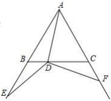

---
id: MAT-8-1-20260829-002-Q10
source: "[[八上-数学-2025北京交大附中期中-20260829#10.]]"
knowledge: "15-3 等腰三角形"
tags: ["八上数学"]
---

（3分）如图，$\triangle ABC$ 是等边三角形，$D$ 是线段 $BC$ 上一点（不与点 $B$，$C$ 重合），连接 $AD$，点 $E$，$F$ 分别在线段 $AB$，$AC$ 的延长线上，且 $DE=DF=AD$，点 $D$ 从 $B$ 运动到 $C$ 的过程中，$\triangle BED$ 周长的变化规律是（）

A. 不变

B. 一直变小

C. 先变大后变小

D. 先变小后变大

> [!question]- 点击查看答案与解析
> 【答案】D
> 
> 【考点】等边三角形的性质、含 $30^{\circ}$ 角的直角三角形性质、等腰三角形三线合一 → [[【初中数学知识点体系-人教版】#15-3 等腰三角形]]
> 
> 【解析】
> 设等边三角形边长为 $a$，$BD=x$。
> 
> 因为 $DE=DA$，$\triangle ADE$ 是等腰三角形。作 $DH\perp AB$ 于 $H$，由三线合一，$H$ 是 $AE$ 的中点，即 $AE=2AH$。
> 
> 在 $Rt\triangle BHD$ 中，$\angle HBD=\angle ABC=60^{\circ}$，所以 $\angle BDH=30^{\circ}$，得 $BH=\frac{1}{2}BD=\frac{x}{2}$（含 $30^{\circ}$ 角的直角三角形，$30^{\circ}$ 角所对的直角边等于斜边的一半）。
> 
> 于是 $AH=AB-BH=a-\frac{x}{2}$，$AE=2AH=2a-x$，
> 所以 $BE=AE-AB=a-x$，恰有 $BE=BC-BD=CD$。
> 
> 故 $\triangle BED$ 的周长 $=BD+BE+DE=x+(a-x)+AD=a+AD=BC+AD$。
> 
> $D$ 从 $B$ 向 $BC$ 中点运动时，$AD$ 逐渐变小（垂线段最短，$AD\perp BC$ 时最小，此时 $D$ 为中点）；从中点向 $C$ 运动时，$AD$ 逐渐变大。所以周长先变小后变大，选 D。
> 
> 验证（数值扫描 5 项全部通过）：取边长 $a=1$，$t=0.1,0.25,0.5,0.75,0.9$ 逐一求解 $E$ 点，均有 $BE=1-t=CD$，且周长 $=1+AD$ 依次为 $1.9539,1.9014,1.8660,1.9014,1.9539$，在 $t=0.5$（$BC$ 中点）处最小，先减后增。**修正说明**：原答案 A（不变）错误——原解析虽推出周长 $=BC+AD$，却又断言"周长 $=BC$ 保持不变"，漏算了 $DE=AD$ 这一项且自相矛盾；$AD$ 随 $D$ 位置变化，中点处最短，故正确规律为先变小后变大（D）。原解析残留"实际上""需要重新分析"等试错叙述，已清理；锚点 `#13-1 等腰三角形` 改为 `#15-3 等腰三角形`，frontmatter 同步更新。
> 
> 【易错点】容易误以为 $DE=AD$ 为"定长"而得出周长不变：实际上 $AD$ 本身随 $D$ 的位置变化，必须先把 $BE$ 转化为 $CD$，将周长化简为 $BC+AD$，再依据"垂线段最短"判断 $AD$ 先减后增。
