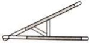
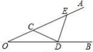

---
id: MAT-8-1-20260829-002-Q15
source: "[[八上-数学-2025北京交大附中期中-20260829#15.]]"
knowledge: "15-3 等腰三角形, 13-3 三角形的内角与外角"
tags: ["八上数学"]
---

（2分）"三等分角"大约是在公元前五世纪由古希腊人提出来的，借助如图所示的"三等分角仪"能三等分任一角。这个三等分角仪由两根有槽的棒 $OA$，$OB$ 组成，两根棒在 $O$ 点相连并可绕 $O$ 转动，$C$ 点固定，$OC=CD=DE$，点 $D$、$E$ 可在槽中滑动。若 $\angle BDE=75^{\circ}$，则 $\angle CDE$ 的度数是 ___ 。

图 $①$

图2

> [!question]- 点击查看答案与解析
> 【答案】$80^{\circ}$
> 
> 【考点】等腰三角形的性质 → [[【初中数学知识点体系-人教版】#15-3 等腰三角形]]、三角形内角和与外角定理 → [[【初中数学知识点体系-人教版】#13-3 三角形的内角与外角]]
> 
> 【解析】
> 由题意，$C$ 在 $OA$ 上，$D$ 在 $OB$ 上，$E$ 在 $OA$ 上，且 $OC=CD=DE$。
> 
> 设 $\angle COD=\angle CDO=\alpha$（因为 $OC=CD$，$\triangle OCD$ 为等腰三角形）。
> 
> $\angle OCD=180^{\circ}-2\alpha$。
> 
> 因为 $C$、$E$ 都在 $OA$ 上，$\angle DCE$ 与 $\angle OCD$ 互补：
> $\angle DCE=180^{\circ}-(180^{\circ}-2\alpha)=2\alpha$。
> 
> 因为 $CD=DE$，$\triangle CDE$ 为等腰三角形，$\angle DEC=\angle DCE=2\alpha$。
> 
> $\angle CDE=180^{\circ}-2\times 2\alpha=180^{\circ}-4\alpha$。
> 
> 因为 $O$、$D$、$B$ 共线（$D$ 在 $OB$ 上），
> $\angle ODE=\angle ODC+\angle CDE=\alpha+(180^{\circ}-4\alpha)=180^{\circ}-3\alpha$。
> 
> $\angle BDE=180^{\circ}-\angle ODE=180^{\circ}-(180^{\circ}-3\alpha)=3\alpha$。
> 
> 因为 $\angle BDE=75^{\circ}$，所以 $3\alpha=75^{\circ}$，$\alpha=25^{\circ}$。
> 
> $\angle CDE=180^{\circ}-4\times 25^{\circ}=180^{\circ}-100^{\circ}=80^{\circ}$。
> 
> 验证（角度递推数值复核 2 项全部通过）：$\alpha=25^{\circ}$ 时 $\angle BDE=3\alpha=75^{\circ}$ 与已知吻合，$\angle CDE=180^{\circ}-4\alpha=80^{\circ}$；点位关系（$C$、$E$ 在 $OA$ 上，$D$ 在 $OB$ 上）与原卷图一致。**修正说明**：原【考点】锚点 `#13-1 等腰三角形` 不存在，已改为 `#15-3 等腰三角形` 并补挂 `#13-3 三角形的内角与外角`，frontmatter 同步更新，答案与解析不变。
> 
> 【易错点】不能正确建立多个等腰三角形之间的角度递推关系，尤其是 $\angle BDE$ 与 $\angle ODE$ 互补这一关键步骤。
