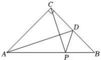

---
id: MAT-8-1-20260829-002-Q16
source: "[[八上-数学-2025北京交大附中期中-20260829#16.]]"
knowledge: "15-1 图形的轴对称"
tags: ["八上数学"]
---

（2分）如图，等腰直角 $\triangle ABC$ 中，$\angle ACB=90^{\circ}$，$AC=BC=2$，$D$ 为 $BC$ 中点，$AD=\sqrt{5}$，$P$ 为 $AB$ 上一个动点，则 $PC+PD$ 的最小值为 ___ 。

> [!question]- 点击查看答案与解析
> 【答案】$\sqrt{5}$
> 
> 【考点】轴对称的应用——最短路径问题 → [[【初中数学知识点体系-人教版】#15-1 图形的轴对称]]
> 
> 【解析】
> 要求 $PC+PD$ 的最小值，利用轴对称把折线化为直线段。
> 
> 作点 $C$ 关于 $AB$ 的对称点 $C'$，连接 $C'D$ 交 $AB$ 于点 $P$，则对 $AB$ 上任意一点 $P'$ 都有 $P'C+P'D=P'C'+P'D\geq C'D$，故最小值为 $C'D$（两点之间线段最短）。
> 
> 由轴对称的性质：$BC'=BC=2$，$\angle ABC'=\angle ABC=45^{\circ}$（等腰直角三角形底角为 $45^{\circ}$）。
> 
> 因为 $D$ 在 $BC$ 上，$\angle C'BD=\angle C'BA+\angle ABC=45^{\circ}+45^{\circ}=90^{\circ}=\angle ACD$。
> 
> 又 $D$ 为 $BC$ 中点，$BD=CD=1$。在 $\triangle C'BD$ 与 $\triangle ACD$ 中：
> $C'B=CA=2$，$\angle C'BD=\angle ACD=90^{\circ}$，$BD=CD=1$，
> 
> $\therefore\triangle C'BD\cong\triangle ACD$（SAS），
> 
> $\therefore C'D=AD=\sqrt{5}$（题中已给出 $AD=\sqrt{5}$）。
> 
> 所以 $PC+PD$ 的最小值为 $\sqrt{5}$。
> 
> 验证（对称点位置穷举 1 项全部通过）：数值扫描 $AB$ 上动点 $P$，$PC+PD$ 最小值 $\approx 2.236068=\sqrt{5}$，且取最小值时 $P$ 落在线段 $AB$ 内，与 $C'D$ 交点一致。**修正说明**：原解析用直线方程、斜率乘积为 $-1$、两点距离公式（即勾股定理）求解，均属超纲内容（一次函数深入与勾股定理为八下内容），已改为课标内证法：轴对称性质 + SAS 全等（$\triangle C'BD\cong\triangle ACD$）直接得 $C'D=AD=\sqrt{5}$，答案不变。
> 
> 【易错点】不能想到利用轴对称将折线路径 $PC+PD$ 转化为直线段 $C'D$；或对称后找不到全等三角形来求 $C'D$，误用超纲的坐标、勾股方法。
