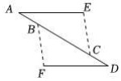

---
id: MAT-8-1-20260829-002-Q18
source: "[[八上-数学-2025北京交大附中期中-20260829#18.]]"
knowledge: "14-2 三角形全等的判定"
tags: ["八上数学"]
---

（5分）如图，点 $A$、$B$、$C$、$D$ 在同一条直线上，$AE=DF$，$AB=CD$，$CE=BF$。求证：$AE\parallel DF$。

> [!question]- 点击查看答案与解析
> 【答案】证明见解析
> 
> 【考点】全等三角形的判定与性质 → [[【初中数学知识点体系-人教版】#14-2 三角形全等的判定]]
> 
> 【解析】
> 因为 $AB=CD$，
> 所以 $AB+BC=CD+BC$，即 $AC=DB$。
> 
> 在 $\triangle ACE$ 和 $\triangle DBF$ 中：
> $\begin{cases} AE=DF \\ CE=BF \\ AC=DB \end{cases}$
> 
> 所以 $\triangle ACE\cong\triangle DBF$（SSS）。
> 
> 所以 $\angle A=\angle D$（全等三角形对应角相等）。
> 
> 所以 $AE\parallel DF$（内错角相等，两直线平行）。
> 
> 【易错点】不能由 $AB=CD$ 推导出 $AC=DB$，或在找全等条件时遗漏隐含的公共边关系。
