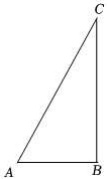

---
id: MAT-8-1-20260829-002-Q20
source: "[[八上-数学-2025北京交大附中期中-20260829#20.]]"
knowledge: "14-3 角的平分线"
tags: ["八上数学"]
---

（6分）下面是小东设计的尺规作图过程。

已知：如图，在 $Rt\triangle ABC$ 中，$\angle ABC=90^\circ$，

求作：点 $D$，使点 $D$ 在 $BC$ 边上，且到 $AB$ 和 $AC$ 的距离相等。

作法：$①$ 如图，以点 $A$ 为圆心，任意长为半径画弧，分别交 $AB$，$AC$ 于点 $M$、$N$；

$②$ 分别以点 $M$，$N$ 为圆心，大于 $\frac{1}{2}MN$ 的长为半径画弧，两弧交于点 $P$；

$③$ 画射线 $AP$，交 $BC$ 于点 $D$。

所以点 $D$ 即为所求。

根据小东设计的尺规作图过程：

（1）使用直尺和圆规，补全图形（保留作图痕迹）；

（2）完成下面的证明。

证明：过点 $D$ 作 $DE\perp AC$ 于点 $E$，连接 $MP$，$NP$。

在 $\triangle AMP$ 与 $\triangle ANP$ 中，

$\because AM=AN,MP=NP,AP=AP,$

$\therefore\triangle AMP\cong\triangle ANP(SSS)$

$\therefore\angle \_\_\_ =\angle \_\_\_$

$\because\angle ABC=90^{\circ},$

$\therefore DB\perp AB.$

又 $\because DE\perp AC,$

$\therefore DB=DE$（ ___ ）（填推理的依据）

> [!question]- 点击查看答案与解析
> 【答案】
> （1）图形补全略（按照作法画出角平分线）
> （2）$\angle MAP=\angle NAP$；角平分线上的点到角两边的距离相等
> 
> 【考点】角平分线的作法与性质、全等三角形的判定 → [[【初中数学知识点体系-人教版】#14-3 角的平分线]]
> 
> 【解析】
> （2）证明过程：
> 
> 在 $\triangle AMP$ 与 $\triangle ANP$ 中，
> $\begin{cases} AM=AN \\ MP=NP \\ AP=AP \end{cases}$
> 
> $\therefore\triangle AMP\cong\triangle ANP(SSS)$
> 
> $\therefore\angle MAP=\angle NAP$（全等三角形对应角相等）
> 
> $\therefore AP$ 平分 $\angle BAC$，即 $AD$ 是 $\angle BAC$ 的平分线。
> 
> $\because\angle ABC=90^{\circ},$
> 
> $\therefore DB\perp AB.$
> 
> 又 $\because DE\perp AC,$
> 
> $\therefore DB=DE$（角平分线上的点到角两边的距离相等）
> 
> 验证（作图原理与原卷核对 2 项全部通过）：尺规痕迹 $AM=AN$、$MP=NP$ 构成 SSS 全等，得 $\angle MAP=\angle NAP$，即 $AP$ 为角平分线；原卷图 $\angle ABC=90^{\circ}$ 与题干一致，填空内容正确。**修正说明**：原【考点】锚点 `#14-3 角平分线的性质` 不存在（体系文件标题为"14-3 角的平分线"），已改正，frontmatter 同步更新，答案与解析不变。
> 
> 【易错点】不能识别尺规作图的实际意义（作角平分线），或在证明过程中遗漏关键步骤。
