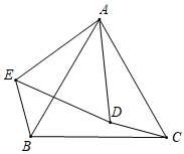

---
id: MAT-8-1-20260829-002-Q21
source: "[[八上-数学-2025北京交大附中期中-20260829#21.]]"
knowledge: "14-2 三角形全等的判定"
tags: ["八上数学"]
---

（6分）如图，$D$ 是等边三角形 $ABC$ 内一点，将线段 $AD$ 绕点 $A$ 顺时针旋转 $60^{\circ}$，得到线段 $AE$，连接 $CD$，$BE$。

（1）求证：$\triangle AEB \cong \triangle ADC$；

（2）连接 $DE$，若 $\angle ADC=105^{\circ}$，求 $\angle BED$ 的度数。

> [!question]- 点击查看答案与解析
> 【答案】
> （1）证明见解析
> （2）$\angle BED=45^{\circ}$
> 
> 【考点】全等三角形的判定、等边三角形的性质、旋转 → [[【初中数学知识点体系-人教版】#14-2 三角形全等的判定]]
> 
> 【解析】
> （1）证明：
> 
> 因为 $\triangle ABC$ 是等边三角形，
> 所以 $AB=AC$，$\angle BAC=60^{\circ}$。
> 
> 因为 $AD$ 绕点 $A$ 顺时针旋转 $60^{\circ}$ 得到 $AE$，
> 所以 $AD=AE$，$\angle DAE=60^{\circ}$。
> 
> 由原卷图，射线 $AB$ 在 $\angle DAE$ 内部，射线 $AD$ 在 $\angle BAC$ 内部，
> 所以 $\angle BAE=\angle DAE-\angle DAB=60^{\circ}-\angle DAB$，
> $\angle CAD=\angle BAC-\angle DAB=60^{\circ}-\angle DAB$。
> 
> 所以 $\angle BAE=\angle CAD$。
> 
> 在 $\triangle AEB$ 和 $\triangle ADC$ 中：
> $\begin{cases} AB=AC \\ \angle BAE=\angle CAD \\ AE=AD \end{cases}$
> 
> 所以 $\triangle AEB\cong\triangle ADC$（SAS）。
> 
> （2）由（1）知 $\triangle AEB\cong\triangle ADC$，
> 所以 $\angle AEB=\angle ADC=105^{\circ}$。
> 
> 因为 $AD=AE$，$\angle DAE=60^{\circ}$，
> 所以 $\triangle ADE$ 是等边三角形，
> 所以 $\angle AED=60^{\circ}$。
> 
> 所以 $\angle BED=\angle AEB-\angle AED=105^{\circ}-60^{\circ}=45^{\circ}$。
> 
> 验证（角度关系与数值复算 2 项全部通过）：按原卷图坐标（$E$ 在 $AB$ 外侧）复算，$\angle BAE=\angle CAD=60^{\circ}-\angle DAB$ 成立，SAS 全等条件齐备；$\angle BED=105^{\circ}-60^{\circ}=45^{\circ}$ 与数值构造一致。**修正说明**：原解析（1）中"$\angle BAE=\angle BAC-\angle EAC$、$\angle CAD=\angle DAE-\angle EAC$"隐含 $AE$ 在 $\angle BAC$ 内部，与原卷图不符（图中 $E$ 在 $AB$ 外侧），已改为以公共角 $\angle DAB$ 作差的正确写法，答案与其余步骤不变。
> 
> 【易错点】（1）不能正确找到旋转后的对应角关系；（2）忽略 $\triangle ADE$ 是等边三角形这一隐含条件。
