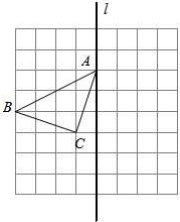

---
id: MAT-8-1-20260829-002-Q22
source: "[[八上-数学-2025北京交大附中期中-20260829#22.]]"
knowledge: "15-1 图形的轴对称"
tags: ["八上数学"]
---

（4分）如图，在 $8\times8$ 的正方形网格中，每个小正方形的边长都为1，网格中有一格点 $\triangle ABC$（即三角形的顶点都在格点上）。

（1）在图中作出 $\triangle ABC$ 关于直线 $l$ 对称的 $\triangle A_{1}B_{1}C_{1}$；（要求 $A$ 与 $A_{1}$，$B$ 与 $B_{1}$，$C$ 与 $C_{1}$ 相对应）

（2）若有一格点 $P$ 到点 $A$，$B$ 的距离相等，则网格中满足条件的点 $P$ 有 ___ 个；

（3）在直线 $l$ 上找到一点 $Q$，使 $QB+QC$ 的值最小。

> [!question]- 点击查看答案与解析
> 【答案】
> （1）图形略
> （2）4个
> （3）$Q$ 为 $B_{1}C$ 与 $l$ 的交点
> 
> 【考点】轴对称作图、线段垂直平分线、最短路径问题 → [[【初中数学知识点体系-人教版】#15-1 图形的轴对称]]
> 
> 【解析】
> （1）分别作出 $A$、$B$、$C$ 关于直线 $l$ 的对称点 $A_{1}$、$B_{1}$、$C_{1}$，连接即可。
> 
> （2）到 $A$、$B$ 距离相等的点在 $AB$ 的垂直平分线上。
> 
> 在网格中，$AB$ 的垂直平分线经过的格点有4个。
> 
> （3）要使 $QB+QC$ 最小，利用轴对称的性质：
> 
> 作 $B$ 关于直线 $l$ 的对称点 $B_{1}$，则 $QB=QB_{1}$。
> 
> 所以 $QB+QC=QB_{1}+QC\geq B_{1}C$（当 $Q$ 在 $B_{1}C$ 上时取等号）。
> 
> 所以 $Q$ 为 $B_{1}C$ 与直线 $l$ 的交点。
> 
> 【易错点】（2）容易遗漏某些格点；（3）不能想到利用轴对称将折线转化为直线段。
