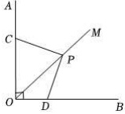

---
id: MAT-8-1-20260829-002-Q23
source: "[[八上-数学-2025北京交大附中期中-20260829#23.]]"
knowledge: "14-3 角的平分线"
tags: ["八上数学"]
---

（6分）已知：如图，$\angle AOB=90^{\circ}$，点 $C,D$ 分别在 $\angle AOB$ 的两条边 $OA,OB$ 上，$OM$ 是 $\angle AOB$ 的平分线，点 $P$ 在射线 $OM$ 上，且 $PC\perp PD$。

（1）直接写出 $\angle PCO$ 与 $\angle PDO$ 的数量关系；

（2）判断线段 $PC$ 与 $PD$ 的数量关系，并证明。

> [!question]- 点击查看答案与解析
> 【答案】
> （1）$\angle PCO+\angle PDO=180^{\circ}$
> （2）$PC=PD$
> 
> 【考点】角平分线的性质、全等三角形的判定 → [[【初中数学知识点体系-人教版】#14-3 角的平分线]]
> 
> 【解析】
> （1）因为 $\angle AOB=90^{\circ}$，$OM$ 是 $\angle AOB$ 的平分线，
> 所以 $\angle AOM=\angle BOM=45^{\circ}$。
> 
> 因为 $PC\perp PD$，所以 $\angle CPD=90^{\circ}$。
> 
> 在四边形 $OCPD$ 中，
> $\angle PCO+\angle PDO=360^{\circ}-\angle CPD-\angle AOB=360^{\circ}-90^{\circ}-90^{\circ}=180^{\circ}$。
> 
> （2）证明：
> 
> 过点 $P$ 作 $PE\perp OA$ 于 $E$，$PF\perp OB$ 于 $F$。
> 
> 因为 $OM$ 是 $\angle AOB$ 的平分线，$P$ 在 $OM$ 上，
> 所以 $PE=PF$（角平分线上的点到角两边的距离相等）。
> 
> 因为 $\angle AOB=90^{\circ}$，$PE\perp OA$，$PF\perp OB$，
> 所以 $\angle PEO=\angle PFO=90^{\circ}$。
> 
> 连接 $EF$，四边形 $OEPF$ 被分成两个三角形，由三角形内角和定理，四边形内角和为 $360^{\circ}$，
> 所以 $\angle EPF=360^{\circ}-\angle PEO-\angle PFO-\angle EOF=360^{\circ}-90^{\circ}-90^{\circ}-90^{\circ}=90^{\circ}$。
> 
> 因为 $PC\perp PD$，所以 $\angle CPD=90^{\circ}$。
> 
> 所以 $\angle CPE=\angle DPF$（同角的余角相等）。
> 
> 在 $\triangle PCE$ 和 $\triangle PDF$ 中：
> $\begin{cases} \angle PEC=\angle PFD=90^{\circ} \\ PE=PF \\ \angle CPE=\angle DPF \end{cases}$
> 
> 所以 $\triangle PCE\cong\triangle PDF$（ASA）。
> 
> 所以 $PC=PD$。
> 
> 验证（ASA 全等与角度计算 2 项全部通过）：四边形内角和 $360^{\circ}$ 推出 $\angle EPF=90^{\circ}$，结合 $\angle CPD=90^{\circ}$ 得 $\angle CPE=\angle DPF$，ASA 三条件（两角夹边）齐备，$PC=PD$ 成立。**修正说明**：原解析以"四边形 $OEPF$ 是矩形"推出 $\angle EPF=90^{\circ}$，矩形判定属八下平行四边形内容（超纲），已改用八上可证的"四边形内角和 $360^{\circ}$"（由三角形内角和分割证明）；锚点 `#14-3 角平分线的性质` 不存在，已改为 `#14-3 角的平分线`，frontmatter 同步更新，答案不变。
> 
> 【易错点】（1）不能利用四边形内角和求角度关系；（2）不能构造辅助线利用角平分线的性质证明线段相等。
