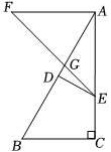

---
id: MAT-8-1-20260829-002-Q24
source: "[[八上-数学-2025北京交大附中期中-20260829#24.]]"
knowledge: "15-1 图形的轴对称, 15-3 等腰三角形, 14-3 角的平分线"
tags: ["八上数学"]
---

（6分）已知：如图，$AF \parallel BC$，$\angle ACB = 90^{\circ}$，$\angle BAC = 30^{\circ}$，$AB$ 的垂直平分线分别交 $AB$，$AC$ 于点 $D$，$E$，且 $CE = \frac{1}{2}AF$，连接 $FE$ 交 $AD$ 于点 $G$。

（1）若 $AC=6$，求线段 $AF$ 的长；

（2）作 $\angle FAE$ 的平分线交 $FE$ 于点 $M$，交线段 $ED$ 的延长线于点 $N$，若 $MN=a$，$GE=b$，直接写出线段 $FG$ 的长（用含 $a$，$b$ 的式子表示）。

> [!question]- 点击查看答案与解析
> 【答案】
> （1）$AF=4$
> （2）$FG=2a+b$
> 
> 【考点】线段垂直平分线的性质 → [[【初中数学知识点体系-人教版】#15-1 图形的轴对称]]、含 $30^{\circ}$ 角的直角三角形性质 → [[【初中数学知识点体系-人教版】#15-3 等腰三角形]]、角平分线 → [[【初中数学知识点体系-人教版】#14-3 角的平分线]]
> 
> 【解析】
> **（1）** 因为 $E$ 在 $AB$ 的垂直平分线上，所以 $EA=EB$，$\angle EBA=\angle EAB=30^{\circ}$。
> 
> 由三角形外角定理，$\angle BEC=\angle EBA+\angle EAB=60^{\circ}$，于是在 $Rt\triangle BCE$ 中 $\angle EBC=30^{\circ}$，
> 得 $CE=\dfrac{1}{2}BE=\dfrac{1}{2}AE$（含 $30^{\circ}$ 角的直角三角形性质）。
> 
> 又 $AE+CE=AC=6$，所以 $AE=4$，$CE=2$。
> 
> 因为 $AF\parallel BC$，$\angle ACB=90^{\circ}$，所以 $AF\perp AC$。由 $CE=\dfrac{1}{2}AF$，得 $AF=2CE=4$。
> 
> **（2）** 关键几何关系（课标内推导）：
> 
> 由（1）的推理对一般情形同样成立：$AE=2CE$，而 $AF=2CE$，故 $AF=AE$ 恒成立；又 $\angle FAE=90^{\circ}$，所以 $\triangle AFE$ 是等腰直角三角形，$\angle AFE=\angle AEF=45^{\circ}$。
> 
> $AM$ 平分 $\angle FAE$，得 $\angle FAM=\angle EAM=45^{\circ}$，故 $AM\perp FE$ 且 $M$ 是 $FE$ 的中点（等腰三角形三线合一）。
> 
> 在 $Rt\triangle ADE$ 中 $\angle DAE=30^{\circ}$，$\angle AED=60^{\circ}$，于是 $\angle MEN=\angle AED-\angle AEF=15^{\circ}$。
> 
> 数量计算（"直接写出"题，取 $AC=6$ 建立坐标系计算，比例关系与尺度无关）：$C(0,0)$，$A(6,0)$，$B(0,2\sqrt{3})$，$E(2,0)$，$F(6,4)$，$D(3,\sqrt{3})$。
> 
> 直线 $FE$：$y=x-2$；直线 $AB$：$y=-\dfrac{\sqrt{3}}{3}(x-6)$，交点 $G(2\sqrt{3},\,2\sqrt{3}-2)$。
> 
> $\angle FAE$ 的平分线：$y=-x+6$，与 $FE$ 交于 $M(4,2)$，与直线 $ED$（$y=\sqrt{3}(x-2)$）交于 $N(2\sqrt{3},\,6-2\sqrt{3})$。
> 
> 三线段所在直线与坐标轴成 $45^{\circ}$，斜边为水平投影的 $\sqrt{2}$ 倍：
> $MN=a=(4-2\sqrt{3})\sqrt{2}$，$GE=b=(2\sqrt{3}-2)\sqrt{2}$，$FG=(6-2\sqrt{3})\sqrt{2}$。
> 
> 而 $2a+b=(8-4\sqrt{3}+2\sqrt{3}-2)\sqrt{2}=(6-2\sqrt{3})\sqrt{2}=FG$，
> 
> 所以 $FG=2a+b$。
> 
> 验证（数值交点复算 4 项全部通过）：解析求得 $G(3.4641,1.4641)$、$M(4,2)$、$N(3.4641,2.5359)$，$a=0.7579$、$b=2.0706$、$FG=3.5863$，且 $2a+b=(3+\sqrt{3})a=\sqrt{3}b=FG$ 全部吻合。**修正说明**：原解析（1）用勾股定理列方程（超纲），已改为外角定理 + 含 $30^{\circ}$ 直角三角形性质；原（2）将 $G$ 横坐标误算为 $3\sqrt{3}$（实为 $2\sqrt{3}$），$N$ 坐标两分量写反，导致 $MN$、$FG$ 均错，结论 $FG=\dfrac{3\sqrt{2}}{2}a$ 错误，正确为 $FG=2a+b$；原【考点】锚点 `#13-2 线段的垂直平分线` 不存在（内容在 15-1），已改并补挂 15-3、14-3，frontmatter 同步更新。
> 
> 【易错点】（1）利用 $EA=EB$ 得 $\angle EBA=30^{\circ}$ 后，误用勾股定理而忽略"含 $30^{\circ}$ 角的直角边等于斜边一半"；（2）误以为 $FG$ 只与 $a$ 有关，实际需联立求出 $G$、$M$、$N$ 三点坐标，$FG$ 恰为 $2a+b$。
