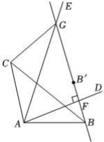
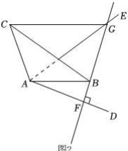

---
id: MAT-8-1-20260829-002-Q25
source: "[[八上-数学-2025北京交大附中期中-20260829#25.]]"
knowledge: "15-1 图形的轴对称"
tags: ["八上数学"]
---

（7分）在 $\triangle ABC$ 中，$\angle BAC=110^{\circ}$，$AC=AB$，射线 $AD$，$AE$ 的夹角为 $55^{\circ}$，过点 $B$ 作 $BF\perp AD$ 于点 $F$，直线 $BF$ 交 $AE$ 于点 $G$，连 $CG$。

图1

图2

（1）如图1，射线 $AD$，$AE$ 都在 $\angle BAC$ 的内部。

$①$ 设 $\angle BAD=\alpha$，则 $\angle CAG=$ ___ （用含有 $\alpha$ 的式子表示）；

$②$ 作点 $B$ 关于直线 $AD$ 的对称点 $B^{\prime}$，则线段 $B^{\prime}G$ 与图1中已有线段 ___ 的长度相等；

（2）如图2，射线 $AE$ 在 $\angle BAC$ 的内部，射线 $AD$ 在 $\angle BAC$ 的外部，其他条件不变，用等式表示线段 $BF$，$BG$，$CG$ 之间的数量关系，并证明。

> [!question]- 点击查看答案与解析
> 【答案】
> （1）$①$ $55^{\circ}-\alpha$
> $②$ $CG$
> （2）$CG=BG+2BF$
> 
> 【考点】轴对称的性质、全等三角形的判定 → [[【初中数学知识点体系-人教版】#15-1 图形的轴对称]]
> 
> 【解析】
> （1）$①$ $\angle DAE=55^{\circ}$，$\angle BAD=\alpha$。
> 
> 因为 $AD$，$AE$ 都在 $\angle BAC=110^{\circ}$ 内部，
> $\angle BAC=\angle BAD+\angle DAE+\angle CAE=110^{\circ}$，
> $\alpha+55^{\circ}+\angle CAE=110^{\circ}$，
> $\angle CAE=55^{\circ}-\alpha$。
> 
> 因为 $G$ 在 $AE$ 上，所以 $\angle CAG=\angle CAE=55^{\circ}-\alpha$。
> 
> $②$ 因为 $B^{\prime}$ 是 $B$ 关于 $AD$ 的对称点，
> 所以 $AB^{\prime}=AB=AC$，$\angle DAB^{\prime}=\angle DAB=\alpha$。
> 
> 于是 $\angle B^{\prime}AG=\angle DAE-\angle DAB^{\prime}=55^{\circ}-\alpha=\angle CAG$。
> 
> 在 $\triangle AB^{\prime}G$ 与 $\triangle ACG$ 中：$AB^{\prime}=AC$，$\angle B^{\prime}AG=\angle CAG$，$AG=AG$，
> 所以 $\triangle AB^{\prime}G\cong\triangle ACG$（SAS），
> 所以 $B^{\prime}G=CG$。
> 
> （2）证明：如图2，作点 $B$ 关于直线 $AD$ 的对称点 $B^{\prime}$，连接 $AB^{\prime}$，则 $B^{\prime}$ 在直线 $BF$ 上。
> 
> 因为 $BF\perp AD$ 于 $F$，所以 $F$ 为 $BB^{\prime}$ 的中点，$BB^{\prime}=2BF$。
> 
> 设 $\angle BAD=\beta$。由轴对称：$AB^{\prime}=AB=AC$，$\angle DAB^{\prime}=\angle DAB=\beta$。
> 
> 因为 $AD$ 在 $\angle BAC$ 外部，$\angle BAE=\angle DAE-\angle DAB=55^{\circ}-\beta$，
> 所以 $\angle CAG=\angle BAC-\angle BAE=110^{\circ}-(55^{\circ}-\beta)=55^{\circ}+\beta$；
> 又 $\angle B^{\prime}AG=\angle B^{\prime}AD+\angle DAE=\beta+55^{\circ}$，
> 所以 $\angle B^{\prime}AG=\angle CAG$。
> 
> 在 $\triangle AB^{\prime}G$ 与 $\triangle ACG$ 中：$AB^{\prime}=AC$，$\angle B^{\prime}AG=\angle CAG$，$AG=AG$，
> 所以 $\triangle AB^{\prime}G\cong\triangle ACG$（SAS），所以 $B^{\prime}G=CG$。
> 
> 由图2，$G$、$B$、$F$、$B^{\prime}$ 依次在同一条直线上，
> 所以 $B^{\prime}G=BG+BB^{\prime}=BG+2BF$，
> 
> 所以 $CG=BG+2BF$。
> 
> 验证（三组角度数值复算 3 项全部通过）：取 $\angle BAD=\beta=20^{\circ},30^{\circ},40^{\circ}$ 逐一构造图形，均有 $B^{\prime}G=CG$ 且 $CG=BG+2BF$（如 $\beta=20^{\circ}$：$CG=B^{\prime}G=1.6840$，$BG+2BF=1.0000+0.6840$），点序为 $G$、$B$、$F$、$B^{\prime}$。**修正说明**：原答案"$BF=BG+CG$"错误，且原证明以"$G$ 在 $AD$ 的垂直平分线上故 $GB=GB^{\prime}$"为据——$G$ 在 $AE$ 上而非 $AD$ 上，该步不成立；原证明又写"$BB^{\prime}=BG+B^{\prime}G$"与图2点序（$B$ 在 $G$、$B^{\prime}$ 之间）矛盾，并以"实际上通过图形分析可得"搪塞，已改为 SAS 全等 + 正确点序的完整证明，结论为 $CG=BG+2BF$。
> 
> 【易错点】一是误用"$GB=GB^{\prime}$"（$G$ 在 $AE$ 上，不在对称轴 $AD$ 上，到 $B$、$B^{\prime}$ 距离并不相等）；二是忽略图2中直线上的点序为 $G$、$B$、$F$、$B^{\prime}$，错把 $B^{\prime}G$ 写成 $BB^{\prime}-BG$，正确关系是 $B^{\prime}G=BG+BB^{\prime}=BG+2BF$。
