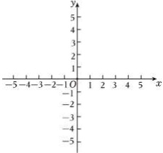
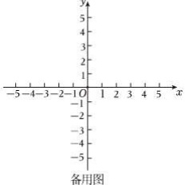

---
id: MAT-8-1-20260829-002-Q26
source: "[[八上-数学-2025北京交大附中期中-20260829#26.]]"
knowledge: "15-1 图形的轴对称, 9-1 用坐标描述平面内点的位置"
tags: ["八上数学"]
---

（7分）如图，在平面直角坐标系 $xOy$ 中，直线 $l$ 经过点 $M(4,0)$，且平行于 $y$ 轴。给出如下定义：点 $P(x,y)$ 先关于 $y$ 轴对称得点 $P_{1}$，再将点 $P_{1}$ 关于直线 $l$ 对称得点 $P^{\prime}$，则称点 $P^{\prime}$ 是点 $P$ 关于 $y$ 轴和直线 $l$ 的二次反射点。

（1）已知 $A(-5,0)$，$B\left(\frac{1}{2},1\right)$，$C(3,-1)$，则它们关于 $y$ 轴和直线 $l$ 的二次反射点 $A^{\prime}$，$B^{\prime}$，$C^{\prime}$ 的坐标分别是 $A^{\prime} = $ ___ ，$B^{\prime} = $ ___ ，$C^{\prime} = $ ___ ；

（2）若点 $D$ 的坐标是 $(a,0)$，点 $D$ 关于 $y$ 轴和直线 $l$ 的二次反射点是点 $D^{\prime}$，求线段 $DD^{\prime}$ 的长；

（3）已知点 $P(a,1)$，$Q(a+1,1)$，$E(5-a,0)$，$F(7-a,0)$，以线段 $EF$ 为边在 $x$ 轴上方作正方形 $EFGH$，若点 $P$，$Q$ 关于 $y$ 轴和直线 $l$ 的二次反射点分别为 $P^{\prime}$，$Q^{\prime}$，且线段 $P^{\prime}Q^{\prime}$ 与正方形 $EFGH$ 的边有公共点，直接写出 $a$ 的取值范围。

图1

备用图

> [!question]- 点击查看答案与解析
> 【答案】
> （1）$A^{\prime}(3,0)$，$B^{\prime}\left(\frac{17}{2},1\right)$，$C^{\prime}(11,-1)$
> （2）$DD^{\prime}=8$
> （3）$-2\leq a\leq-\dfrac{3}{2}$ 或 $-1\leq a\leq-\dfrac{1}{2}$
> 
> 【考点】轴对称的性质、用坐标描述平面内点的位置 → [[【初中数学知识点体系-人教版】#15-1 图形的轴对称]]、[[【初中数学知识点体系-人教版】#9-1 用坐标描述平面内点的位置]]
> 
> 【解析】
> **求变换规则**：设 $P(x,y)$，直线 $l$ 为 $x=4$。
> 
> 第一步：关于 $y$ 轴对称，$P_1(-x,y)$；
> 
> 第二步：关于直线 $x=4$ 对称，两点纵坐标相同、横坐标之和等于 $2\times 4=8$，得 $P^{\prime}(8+x,\,y)$。
> 
> 所以"二次反射点"的变换规则为：$(x,y)\rightarrow(8+x,y)$。
> 
> **（1）**
> $A(-5,0)\rightarrow A^{\prime}(3,0)$
> $B\left(\frac{1}{2},1\right)\rightarrow B^{\prime}\left(\frac{17}{2},1\right)$
> $C(3,-1)\rightarrow C^{\prime}(11,-1)$
> 
> **（2）** $D(a,0)\rightarrow D^{\prime}(8+a,0)$，两点都在 $x$ 轴上，
> 
> $DD^{\prime}=|(8+a)-a|=8$。
> 
> **（3）** $P(a,1)\rightarrow P^{\prime}(8+a,1)$，$Q(a+1,1)\rightarrow Q^{\prime}(9+a,1)$，
> 线段 $P^{\prime}Q^{\prime}$ 在直线 $y=1$ 上，$x\in[8+a,\,9+a]$。
> 
> 正方形 $EFGH$ 在 $x$ 轴上方，$EF=2$：$E(5-a,0)$，$F(7-a,0)$，$G(7-a,2)$，$H(5-a,2)$，
> 即正方形为 $x\in[5-a,\,7-a]$，$y\in[0,\,2]$。
> 
> 因为 $y=1$ 严格介于 $0$ 与 $2$ 之间，线段 $P^{\prime}Q^{\prime}$ 只可能与竖直边 $HE$（$x=5-a$）或 $FG$（$x=7-a$）有公共点：
> 
> 与 $HE$ 相交：$8+a\leq 5-a\leq 9+a$，得 $-2\leq a\leq-\dfrac{3}{2}$；
> 
> 与 $FG$ 相交：$8+a\leq 7-a\leq 9+a$，得 $-1\leq a\leq-\dfrac{1}{2}$。
> 
> （当 $-\dfrac{3}{2}<a<-1$ 时，线段 $P^{\prime}Q^{\prime}$ 完全落在正方形内部，与边无公共点，须舍去。）
> 
> 所以 $-2\leq a\leq-\dfrac{3}{2}$ 或 $-1\leq a\leq-\dfrac{1}{2}$。
> 
> 验证（数值扫描 0.01 步长 1 项全部通过）：对 $a\in[-2.6,-0.0]$ 逐点检验线段 $P^{\prime}Q^{\prime}$ 与正方形各边交点，命中区间恰为 $[-2,-1.5]$ 与 $[-1,-0.5]$ 两段。**修正说明**：原题干系虚构（把对称直线写成 $l$：$y=x$，各小问数据均与原卷不符），已按原卷改为"$l$ 过 $M(4,0)$ 平行于 $y$ 轴"的正确定义与数据；原解析按虚构题干得出 $(x,y)\rightarrow(y,-x)$ 及（3）"$2\leq a\leq 3$"（该区间内 $P^{\prime}Q^{\prime}$ 位于 $x$ 轴下方，与正方形本无公共点，自身亦不成立），三问答案与解析全部按原卷重写。
> 
> 【易错点】一是误把第二次对称当作关于 $y=x$ 对称（实为关于直线 $x=4$ 对称，横坐标变为 $8+x$、纵坐标不变）；二是（3）中漏掉"线段完全在正方形内部"的中间情形，把两段区间错写成连续区间。
