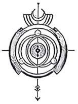
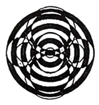
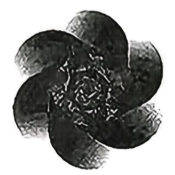
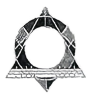

1. （2025八上·北京期中）在我校初二年级数学“对称之美”徽章设计实践活动中，以下同学的原创设计作品充满想象力和创造力，请选出其中不是轴对称的图案（ ）（只考虑图形特征，不考虑颜色）

A. 

B. 

C. 

D. 

> [!question]- 点击查看答案与解析
> 【答案】D
> 
> 【考点】轴对称图形的识别 → [[【初中数学知识点体系-人教版】#15-1 图形的轴对称]]
> 
> 【解析】
> 判断一个图案是不是轴对称图形，只需看能否找到一条直线，使图形沿它折叠后两部分完全重合（本题只看图形结构，不看黑白填色）。
> - A：圆形徽章——外圈圆环、中部同心圆、左右两枚小圆与两道短横线都成对分布，上部冠饰与下部竖杆、箭头也都居中，存在竖直对称轴；
> - B：同心圆环与斜向条带交替排列，关于过圆心的竖直直线（以及斜对角线）对称；
> - C：五瓣花形徽章，各花瓣大致等分圆周，存在过花瓣的对称轴；
> - D：三角形外框与内部的圆环不同心，环上的分割线左右位置错开，下部横带上的花纹左右也不相同，沿任何一条直线折叠都不能重合，不是轴对称图形。
> 综上，选 D。
> 
> 【易错点】① 把“上下结构不同”当成“不是轴对称”——判断轴对称只需存在一条对称轴，并不要求上下两部分相同；② 把黑白填色当成图形特征，题中已说明“不考虑颜色”，需要看的是轮廓、分割线等结构；③ 只顾看外框是三角形就以为对称，忽略内部圆环与外框不同心。
