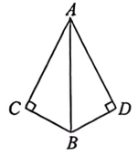

3. （2025八上·北京期中）如图，$\angle C=\angle D=90^{\circ}$，$BC=BD$，则证明 $\triangle BAC\cong\triangle BAD$ 的理由是（ ）

A. $SAS$

B. $ASA$

C. $AAS$

D. $HL$

> [!question]- 点击查看答案与解析
> 【答案】D
> 
> 【考点】直角三角形全等的判定（HL）→ [[【初中数学知识点体系-人教版】#14-2 三角形全等的判定]]
> 
> 【解析】
> $\angle C=\angle D=90^{\circ}$，$BC$ 与 $BD$ 是各自的直角边，$AB$ 是两个三角形的公共斜边。
> “斜边和一条直角边分别相等”对应的判定方法是 $HL$，所以理由是 $HL$。
> 注意：$BC=BD$ 中的 $BC$ 并不夹在 $\angle C$ 与 $\angle A$ 之间，不能用 $SAS$；$\angle C$、$\angle D$ 也不是夹 $AB$ 的角，$AAS$ 同样不成立。
> 故选 D。
> 
> 【易错点】看到“两个直角 + 一条公共边”就直接写 $SAS$ 或 $AAS$；忘记 $HL$ 只适用于直角三角形。
