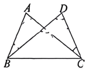

4. （2025八上·北京期中）如图，$\triangle ABC\cong\triangle DCB$，若 $\angle D=75^{\circ}$，$\angle DBC=40^{\circ}$，则 $\angle ABC$ 的度数是（ ）

A. $65^{\circ}$

B. $70^{\circ}$

C. $75^{\circ}$

D. $55^{\circ}$

> [!question]- 点击查看答案与解析
> 【答案】A
> 
> 【考点】全等三角形的对应角相等 → [[【初中数学知识点体系-人教版】#14-1 全等三角形及其性质]]
> 
> 【解析】
> $\triangle ABC\cong\triangle DCB$ 的对应关系是 $A\leftrightarrow D$、$B\leftrightarrow C$、$C\leftrightarrow B$，
> 所以 $\angle A=\angle D=75^{\circ}$，$\angle ABC$ 的对应角是 $\angle DCB$。
> 在 $\triangle DCB$ 中，$\angle DCB=180^{\circ}-\angle D-\angle DBC=180^{\circ}-75^{\circ}-40^{\circ}=65^{\circ}$，
> 故 $\angle ABC=65^{\circ}$。选 A。
> 
> 【易错点】把 $\angle ABC$ 的对应角错认成 $\angle D$ 或 $\angle DBC$（书写 $\triangle ABC\cong\triangle DCB$ 时对应字母要一一对齐）。
