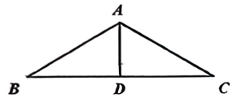

5. （2025八上·北京期中）如图，$\triangle ABC$ 是等腰三角形，$AB=AC$，$AD$ 是底边 $BC$ 上的高，下面结论不一定成立的是（ ）

A. $BD=CD$

B. $BD=AD$

C. $AD$ 平分 $\angle BAC$

D. $\angle B=\angle C$

> [!question]- 点击查看答案与解析
> 【答案】B
> 
> 【考点】等腰三角形“三线合一”→ [[【初中数学知识点体系-人教版】#15-3 等腰三角形]]
> 
> 【解析】
> $AB=AC$，$AD$ 是底边 $BC$ 上的高，由等腰三角形“三线合一”得：
> $AD$ 也是 $BC$ 边上的中线、顶角 $\angle BAC$ 的平分线，所以 $BD=CD$，$\angle BAD=\angle CAD$，A、C 都成立；
> 由“等边对等角”得 $\angle B=\angle C$，D 成立；
> $BD$ 与 $AD$ 之间没有必然的大小关系（只有当顶角 $\angle BAC=90^{\circ}$、即 $\triangle ABC$ 是等腰直角三角形时才有 $BD=AD$），所以不一定成立的是 B。
> 
> 【易错点】把“三线合一”理解成“高 = 中线 = 底边的一半”；忽视 $BD$ 是底边的一半、$AD$ 是腰上的高，二者不可比。
