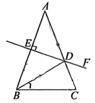

6. （2025八上·北京期中）如图，在 $\triangle ABC$ 中，$AB=AC$，$\angle C=70^{\circ}$，线段 $AB$ 的垂直平分线 $EF$ 交 $AC$ 于点 $D$，交 $AB$ 于点 $E$，连接 $BD$，则 $\angle DBC$ 的度数是（ ）

A. $40^{\circ}$

B. $20^{\circ}$

C. $30^{\circ}$

D. $25^{\circ}$

> [!question]- 点击查看答案与解析
> 【答案】C
> 
> 【考点】线段垂直平分线的性质 → [[【初中数学知识点体系-人教版】#15-1 图形的轴对称]]、等腰三角形的性质 → [[【初中数学知识点体系-人教版】#15-3 等腰三角形]]
> 
> 【解析】
> $AB=AC$，$\angle C=70^{\circ}$ $\Rightarrow$ $\angle ABC=70^{\circ}$，$\angle A=180^{\circ}-70^{\circ}-70^{\circ}=40^{\circ}$。
> $EF$ 垂直平分 $AB$，点 $D$ 在 $EF$ 上，由“线段垂直平分线上的点到线段两端点的距离相等”得 $DA=DB$，
> 所以 $\angle ABD=\angle A=40^{\circ}$（等边对等角）。
> 于是 $\angle DBC=\angle ABC-\angle ABD=70^{\circ}-40^{\circ}=30^{\circ}$。选 C。
> 
> 【易错点】把 $\angle ABD$ 与 $\angle DBC$ 的从属关系弄反（$\angle DBC=\angle ABC-\angle ABD$，不是相加）；忘了用垂直平分线先证 $DA=DB$。
